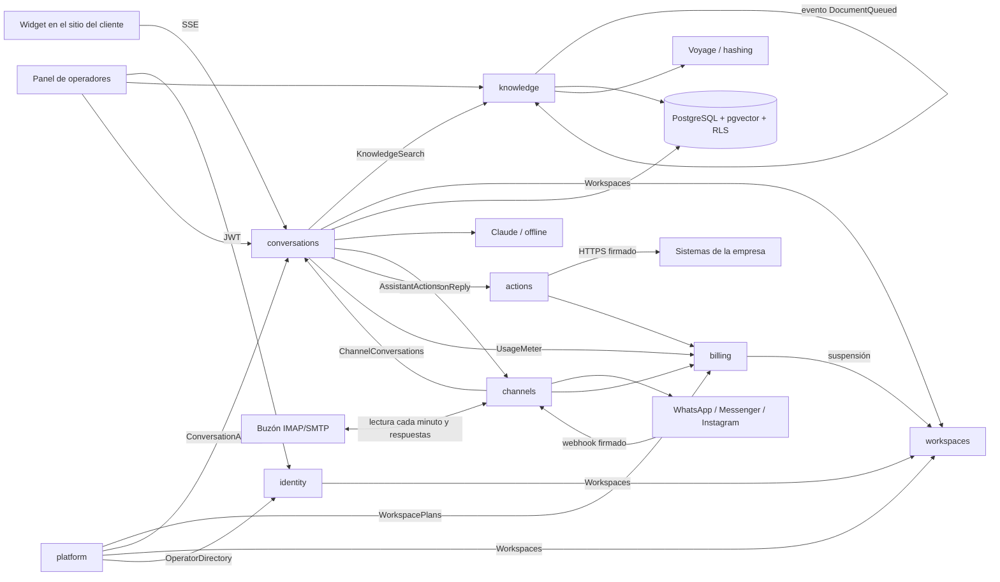
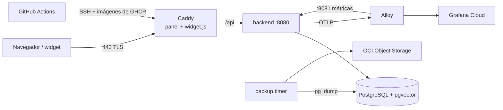

# Plataforma de Atención al Cliente con IA (RAG multi-tenant)

Plataforma SaaS donde cada empresa sube su base de conocimiento (PDF, Word, Excel, HTML, Markdown, texto o las páginas de su sitio web) y obtiene un asistente
que responde a sus clientes **solo con esa información**, citando las fuentes y diciendo "no sé" cuando no la
tiene, en lugar de inventar. Se integra en cualquier sitio con un widget embebible.

> **Estado: Fase 4 completa.** Además de lo anterior, cada workspace paga su plan con Stripe y ve cuántas
> conversaciones resolvió el asistente. El asistente atiende por el widget, WhatsApp, correo, Messenger e Instagram,
> y usa Shopify y Zendesk sin escribir un webhook. La plataforma se monitorea con Grafana Cloud, se despliega sola en
> una VM gratuita de Oracle Cloud y tiene una prueba de carga reproducible.
>
> **Fase 5 en curso:** el asistente recuerda a los clientes que vuelven, cada conversación se etiqueta con su tema,
> el equipo programa seguimientos, quien opera la plataforma la administra desde el panel y hay una demo pública.

## Qué hace hoy

| Capacidad | Detalle |
|---|---|
| Cuentas y workspaces | Registro crea el workspace y su dueño, con los **términos y condiciones** aceptados (públicos en `/legal/terminos`; se guarda cada versión aceptada y su fecha). Si la versión cambia, el panel pide aceptarla antes de seguir. Roles `OWNER`, `ADMIN` y `AGENT`. Una persona puede pertenecer a varios workspaces y cambiar entre ellos sin volver a iniciar sesión |
| Equipo e invitaciones | Dueños y administradores invitan por email con un enlace de un solo uso (7 días, solo se guarda su hash). Quien ya tiene cuenta entra con su contraseña; quien no, la crea al aceptar. El dueño gestiona a todos y cambia roles; un administrador solo invita y quita agentes; nadie toca al dueño |
| Base de conocimiento | Subida de PDF, Word (`.docx`, `.doc`), Excel (`.xlsx`, `.xls`, una línea por fila con sus encabezados: "Producto: Pizza grande · Precio: 189"), HTML (sin menús, scripts ni pies de navegación), Markdown y texto, en UTF-8 o en codificaciones antiguas como Windows-1252. El tipo se reconoce por el contenido, no por la extensión: un ZIP renombrado a `.pdf` se rechaza. Ingesta asíncrona (extracción, chunking con solapamiento, embeddings) con la etapa visible en el panel, reproceso y borrado |
| Importar un sitio web | Se pega la URL de una página y, si se quiere, hasta 30 páginas enlazadas del mismo sitio. Se descarga solo por `http`/`https` a los puertos 80 y 443, nunca a direcciones privadas, de loopback o de metadatos de la nube (también tras cada redirección), con límite de tamaño y de redirecciones. **Actualizar** vuelve a descargarla |
| Playground | Dueños y administradores prueban el asistente con sus propias preguntas antes de publicarlo: la respuesta llega en streaming igual que en el widget y un inspector muestra los fragmentos recuperados (y cuáles usó el modelo), el modelo que respondió y por qué, tokens, latencia, costo y las acciones que habría llamado, sin ejecutarlas. No crea conversaciones; cada respuesta cuenta en el consumo del plan |
| Búsqueda híbrida | Vectorial (pgvector, HNSW coseno) + texto completo (tsvector) fusionadas con Reciprocal Rank Fusion |
| Respuestas fundamentadas | Streaming SSE palabra por palabra, citas `[n]` a los documentos, respuesta fija de "no sé" sin llamar al modelo cuando no hay fuentes relevantes |
| Widget embebible | Una etiqueta `<script>` de 30 KB (10 KB gzip), sin dependencias, aislado en Shadow DOM. Respuesta en streaming, citas que abren su fuente, conversación que sobrevive a recargas, solo en los orígenes que el workspace permite |
| Traspaso a humano | El visitante pulsa **Hablar con una persona**; el asistente deja de responder y sus mensajes esperan al equipo. En el panel la conversación aparece al instante en **En espera**, un agente la toma, responde y la devuelve al asistente o la cierra. Ambos lados se actualizan en vivo por SSE, con avisos en la conversación ("Laura se unió…") |
| Avisos y escalamiento | Un cliente que pide una persona o se nota molesto (quejas, insultos, mayúsculas, "!!!", en cuatro idiomas y sin llamar al modelo) pasa al equipo marcado como **Cliente molesto**, y el dueño recibe un WhatsApp con quién es, qué escribió y el enlace a la conversación, con plantilla aprobada para llegar fuera de la ventana de 24 h. Un aviso por conversación y motivo, con su entrega visible en el panel. También avisa cuando el consumo del mes llega al 80 % y al 95 % del plan |
| Clientes y su memoria | Quien escribe por WhatsApp, correo, Messenger o Instagram se reconoce en cada conversación nueva. **Clientes** los busca por número, correo o nombre y muestra todas sus conversaciones; en cada conversación, la ficha del cliente guarda el nombre que el equipo le da y sus notas. El asistente recibe lo que el cliente dijo en los últimos 30 días (hasta 10 mensajes, sin saludos ni respuestas fallidas, recortado a 2400 caracteres) para no volver a preguntar lo que ya contó. Las notas del equipo nunca llegan al modelo, una respuesta que pudo usar esa memoria nunca se reutiliza para otro cliente, y la ficha permite **no recordar** a un cliente. Los visitantes del widget son anónimos y no se recuerdan |
| Temas de cada conversación | Cada conversación se etiqueta sola, sin llamar al modelo y en cuatro idiomas, con lo que trata: estado del pedido, envíos, devoluciones, pagos, precios, disponibilidad, horarios y ubicación, cuenta o queja. La bandeja se filtra por tema y el equipo corrige los temas de una conversación; desde ese momento ya no se agregan solos |
| Seguimientos | Desde una conversación de WhatsApp, correo, Messenger o Instagram el equipo programa un mensaje para más tarde ("Mañana", "En una semana" o una fecha), escrito a mano o desde una **plantilla** donde `{nombre}` se cambia por el nombre del cliente. Cada minuto salen los que tocan, en la conversación abierta del cliente o en una nueva, a nombre de quien lo programó. Se respeta la ventana de 24 h de Meta: pasadas las 24 h, WhatsApp envía la plantilla aprobada que tenga la plantilla del seguimiento y Messenger e Instagram no envían. **Seguimientos** muestra los programados, enviados, cancelados y los que no se enviaron con el motivo en español |
| Preguntas sin respuesta | Cada "no sé" del asistente se agrupa por pregunta normalizada, con cuántas veces se hizo y la última conversación. Se marcan como resueltas al agregar el documento que las cubre (se reabren si alguien vuelve a preguntar) o se descartan |
| Documentos sugeridos | Las preguntas abiertas que tratan del mismo tema (por similitud de embeddings: "¿Hacen envíos a Colombia?" y "¿Envían a Colombia?") se juntan en un solo documento por escribir, el tema más preguntado primero. Desde el panel se redacta en Markdown sobre un borrador con las preguntas, se sube a la base de conocimiento y sus preguntas quedan resueltas |
| Resultados | El cliente dice si cada respuesta le ayudó (👍/👎) y califica la conversación del 1 al 5 con un comentario opcional, también después de que el equipo la cierra. **Resultados** muestra cuántas conversaciones resolvió el asistente sin ayuda (respondió, nadie del equipo intervino, la última respuesta no se marcó como inútil y la calificación, si hubo, fue de 3 o más), cuántas pasaron a una persona, las respuestas útiles, la calificación promedio y la satisfacción (4 o 5), por día y con los comentarios recientes |
| Evaluación de calidad | 12 casos con base de conocimiento propia miden si el asistente responde o dice "no sé" cuando corresponde, si incluye los datos esperados y si cita la fuente correcta. Corre en cada CI (modo offline) y cada semana contra Claude |
| Panel de operadores | React, con un diseño empresarial: barra lateral agrupada por área (Atención, Asistente, Canales, Analítica, Administración), barra superior con la ruta y los clientes en espera, modo oscuro y sin dependencias de fuentes externas. Conversaciones con fuentes y consumo por respuesta (modelo, tokens, latencia), base de conocimiento (arrastrar varios archivos con barra de subida, etapa de indexado en vivo, importación de sitios web, reproceso, borrado), Playground, probador de búsqueda, configuración del widget con su código de instalación, preguntas sin respuesta y equipo. Lo que cada rol no puede hacer no se muestra |
| Acciones del asistente | Cada empresa describe acciones como "consultar un pedido" o "cambiar la dirección": nombre, cuándo usarlas, los datos que piden (con formato opcional) y la URL de su webhook. El asistente decide cuándo usarlas (tool use) y pide al cliente los datos que falten. Las consultas se ejecutan al momento. Las que cambian algo esperan a que el cliente pulse **Confirmar** (15 min), en el widget o en WhatsApp. Cada llamada va firmada con HMAC y queda registrada en la conversación |
| Shopify y Zendesk | Integraciones listas que se conectan con un token, sin escribir un webhook. Con Shopify el asistente consulta el estado de un pedido (pago, envío, total y seguimiento, nunca la dirección) y lo cancela si el cliente lo confirma; solo muestra o cancela un pedido a quien da el correo con que se hizo (en el canal de correo, el del remitente). Con Zendesk abre un ticket a nombre del cliente, también tras confirmar |
| WhatsApp | Se conecta un número de la Cloud API de WhatsApp Business desde el panel. Los mensajes entrantes (firmados por Meta) siguen el mismo flujo del widget: base de conocimiento, acciones con botones de confirmación y traspaso a humano (escribiendo "quiero hablar con una persona"). Las respuestas del equipo salen por WhatsApp |
| Correo | Se conecta el buzón de soporte por IMAP y SMTP con TLS (en Gmail, con una **contraseña de aplicación**). Cada minuto se leen los correos nuevos, sin marcarlos como leídos; los que llegaron antes de conectar no se responden. Se quita el hilo citado y la firma, y la respuesta sale en el mismo hilo (`Re:`, `In-Reply-To`, `References`). Las acciones que cambian algo se confirman respondiendo **CONFIRMAR** o **CANCELAR**. No se contestan respuestas automáticas, rebotes, listas de correo ni correos que no pasan DMARC. El panel muestra cuándo se leyó el buzón y por qué falló |
| Messenger e Instagram | Se conecta la página de Facebook o la cuenta profesional de Instagram con el token de la página y el secreto de una app de Meta. Comparten el webhook firmado y la Send API: botones de confirmación como respuestas rápidas, nombre del cliente desde su perfil y textos largos partidos en varios mensajes (2000 caracteres en Messenger, 1000 bytes en Instagram). Meta solo deja responder durante 24 h tras el último mensaje del cliente, así que una respuesta del equipo más tarde se descarta |
| Modelo según la pregunta | Las preguntas directas van a un modelo económico (Claude Haiku, esfuerzo bajo). Las que piden razonar, comparar o recomendar (con señales en español, inglés, portugués y francés), las hipotéticas ("si compro 3 y uno llega roto, ¿me devuelven todo?"), las que comparan ("¿por qué mi plan cuesta más que el de mi amigo?"), las que traen varias preguntas, las largas y las que de verdad combinan varios documentos van a uno más capaz (Claude Sonnet). Un "¿por qué?" sobre el caso del propio cliente ("¿por qué no ha llegado mi pedido?") se queda en el económico, y para contar documentos solo valen los casi tan relevantes como el mejor (medido sobre la escala del proveedor de embeddings), sin contar dos veces las páginas que repiten el mismo texto. Si el económico dice "no sé" teniendo fuentes, se reintenta una vez con el capaz. El asistente además **aprende de las preguntas difíciles** (ver abajo). Cada número de WhatsApp puede fijar **Rápido** (siempre el económico) o **Preciso** (siempre el capaz) en lugar de **Automático**, y el Playground deja comparar las tres opciones. El panel muestra qué modelo respondió y por qué |
| Preguntas difíciles | Se guarda cada pregunta con la que el asistente batalló: el modelo rápido no supo, el cliente marcó 👎, dijo "no entendí" o "no me sirvió" (en cuatro idiomas) o volvió a hacer la misma pregunta. Mientras siga abierta, esa pregunta y las parecidas van directo al modelo preciso, y si el cliente muestra que la respuesta no le sirvió, su siguiente mensaje también. Dos preguntas cuentan como la misma si comparten casi todas sus palabras o si significan lo mismo según los embeddings ("¿cuánto tarda el envío?" y "¿en cuántos días llega mi paquete?"). Si nadie la enseña, se cierra sola (**Cerradas solas**) cuando el preciso la responde bien 3 veces seguidas o tras 30 días sin volver a ser difícil, y se reabre con la siguiente señal; así no cuesta de más para siempre. Al repetirse 5 veces sin respuesta enseñada, el dueño recibe un aviso por WhatsApp. En **Preguntas difíciles** se ven la señal, cuántas veces pasó y lo que respondió el asistente; el equipo escribe la respuesta correcta con **Enseñar respuesta** (también desde Preguntas sin respuesta), que llega con un borrador escrito por el modelo preciso a partir de los documentos para solo corregirlo, y queda en la base de conocimiento como un documento. **Resultados** muestra las respuestas por modelo y motivo con su tasa de 👎, para saber qué ajustar |
| Respuestas sin costo | Un mensaje que solo saluda, agradece, se despide o dice "ok" (en español, inglés, portugués y francés) recibe una respuesta fija, sin buscar ni llamar al modelo, y no cuenta en el plan ni como pregunta sin respuesta. Un "ok" a algo que preguntó el asistente sí pasa al modelo. Una pregunta repetida, sin contexto previo, recibe la respuesta que el modelo ya escribió (0 tokens) mientras no cambien los documentos, las acciones ni el nombre del asistente, hasta 7 días; nunca se reutiliza una respuesta que usó una acción ni una que un cliente marcó como inútil |
| Administración de la plataforma | Quienes operan la plataforma (configurados por id de usuario, nunca por correo, porque el registro no comprueba direcciones) ven en el panel todos los workspaces con su dueño y correo, plan, respuestas del mes y conversaciones de los últimos 30 días, sin acceso a sus conversaciones ni a su base de conocimiento. Pueden **suspender** uno con un motivo: su asistente deja de responder y pasa las conversaciones al equipo, igual que un plan agotado, y sus miembros ven el motivo en el panel hasta que se **reactiva** |
| Demo pública | `/demo` muestra el widget de Café Aurora, una cafetería ficticia con su catálogo, envíos, pagos y guía de preparación. `scripts/seed-demo.sh` la prepara con la propia API. Responde siempre con Claude Haiku, tiene un tope diario de respuestas y cada visitante tiene su propio límite de preguntas |
| Despliegue | Una VM gratuita de Oracle Cloud (arm64) con Docker Compose, Caddy con TLS automático, respaldos nocturnos cifrados a Object Storage y despliegue desde GitHub Actions por SSH, con prueba de humo y vuelta atrás a cualquier versión |
| Monitoreo | Métricas de negocio (respuestas, tokens, traspasos, opiniones, acciones, entregas por canal) y trazas OpenTelemetry hacia Grafana Cloud gratis, con un tablero y 12 alertas listas |
| Consumo | Cada workspace registra por día las respuestas (por canal), los tokens (por modelo), las acciones ejecutadas y los mensajes de WhatsApp. **Consumo** muestra el mes frente a lo que incluye su plan |
| Planes y cobro | Planes con cantidades incluidas al mes (gratis, Inicial, Profesional; configurables). El dueño contrata en el checkout de Stripe, cambia de plan o lo cancela al final del periodo, y administra tarjeta y facturas en el portal de Stripe. Lo que pasa del incluido se reporta a los medidores de Stripe y se cobra en la factura. Al llegar al límite de un plan sin cobro extra, el asistente pasa las conversaciones al equipo, las acciones se rechazan y los mensajes de WhatsApp no se contestan, salvo que el dueño compre una **recarga**: un pago único en Stripe que suma unidades (p. ej. 500 respuestas por 10 USD) hasta el fin del mes, sin cambiar de plan. Cuando una cuota pasa del 80 %, **Plan y pagos** marca como **Recomendado** el plan más barato que la cubre. Si un pago falla, el plan sigue 7 días mientras Stripe reintenta; después aplica el gratuito |
| Idiomas | El asistente responde en el idioma en que escribe el cliente. Lo que la plataforma escribe por su cuenta (el "no sé", los errores, las respuestas de las acciones, los avisos de WhatsApp y los textos del widget) sale en español, inglés, portugués o francés: al principio en el del navegador (`Accept-Language`) y después en el de los mensajes del cliente, que se detecta sin llamar al modelo. Con embeddings de Voyage, que son multilingües, una pregunta en inglés encuentra documentos en español; los embeddings offline solo comparan textos del mismo idioma |
| Proveedores | Claude (Anthropic) y Voyage AI, o modos **offline** que funcionan sin API keys para desarrollo, pruebas y demos |

## Arquitectura

Monolito modular (Spring Modulith) con arquitectura limpia dentro de cada módulo. Los módulos solo se hablan por su
API pública y por eventos; las reglas se verifican en cada build (`ModularityTests`, `CleanArchitectureTests`).



Cada módulo (`identity`, `workspaces`, `knowledge`, `conversations`, `actions`, `channels`, `billing`, `platform`) se
organiza así:

```
<módulo>/                 API pública del módulo (interfaces y records que otros módulos pueden usar)
  domain/model/           reglas de negocio puras, sin Spring ni base de datos
  domain/port/            interfaces que el dominio necesita (repositorios, modelos de IA)
  application/            casos de uso y transacciones
  infrastructure/         adaptadores: JDBC, clientes HTTP de IA, configuración
  web/                    controladores REST
```

`shared` contiene lo transversal: tenancy, errores (RFC 9457), rate limiting, correlation id.

Los frontends viven junto al backend:

```
backend/   API (Java 25, Spring Boot)
widget/    widget.js para los sitios de los clientes (TypeScript sin framework, Vite)
panel/     panel de operadores (React, React Router, TanStack Query, Vite)
```

### Decisiones técnicas relevantes

- **Aislamiento de tenants en la base de datos, no solo en el código.** Las tablas con datos de clientes tienen
  Row-Level Security (`ENABLE` + `FORCE`). Cada transacción fija `app.workspace_id`. Si alguien olvida el filtro, o no
  hay workspace ligado, la base devuelve **cero filas**: falla cerrado. La aplicación se conecta con un rol que no es
  dueño de ninguna tabla. Flyway migra con el rol dueño.
- **JdbcClient en lugar de JPA**: SQL explícito para pgvector, tsvector, `FOR UPDATE` y CTEs de búsqueda.
- **Ingesta con outbox** (eventos de Spring Modulith): si el proceso muere a la mitad, el evento se reintenta al
  arrancar. Un documento atascado en `PROCESSING` se recupera tras 10 minutos.
- **Hilos virtuales**: cada respuesta en streaming ocupa un hilo bloqueado mientras el modelo escribe, lo que es
  barato con hilos virtuales. Ninguna transacción queda abierta durante la generación.
- **Validar antes de transmitir**: la pregunta se autentica, valida y registra antes del primer byte del stream, así
  los errores son respuestas HTTP normales. Una vez iniciado el stream, cualquier fallo se convierte en un mensaje
  amable dentro de él.
- **Widget sin framework**: se carga en cada página de cada cliente, así que es TypeScript puro con un presupuesto de
  30 KB que la build hace cumplir. Lee el SSE con `fetch` (EventSource no permite POST ni headers). Todo el texto del
  servidor se inserta como texto, nunca como HTML. La conversación se crea con la primera pregunta, no al cargar la
  página. Si el token del visitante expiró, abre una conversación nueva y reintenta una sola vez.
- **Actualizaciones en vivo con SSE, no WebSockets**: el servidor solo empuja (cambios de estado y mensajes) y el
  cliente escribe con POST normales, así que SSE basta, pasa por cualquier proxy y reutiliza la autenticación de
  siempre. Cada conexión se cierra a los 15 (panel) o 30 minutos (widget) para que el cliente vuelva a autenticarse.
- **Varias instancias con PostgreSQL `LISTEN/NOTIFY`**: cada cambio hace `pg_notify` dentro de su transacción, así
  que PostgreSQL lo entrega a todas las réplicas solo si confirma y en orden de commit. El aviso lleva solo ids
  (tipo, workspace, conversación, mensaje); la réplica que tiene streams abiertos lee el estado actual con RLS y lo
  empuja, y las demás no consultan nada. Cada réplica escucha con una conexión propia fuera del pool; si se cae,
  reconecta y cierra sus streams para que los clientes recarguen lo que se perdió: el panel vuelve a pedir sus
  listas y el widget, al abrir cada stream, trae del historial las respuestas del equipo que no tenga en pantalla. No
  hace falta Redis.
- **El traspaso no consume preguntas**: solo cuentan para el límite por conversación las que responde el asistente,
  que son las que cuestan tokens. Los avisos del sistema se guardan como códigos y cada cliente los traduce.
- **Acciones como webhooks, no como código**: el modelo solo propone la llamada (nombre y datos). La plataforma
  valida los datos contra la definición (tipos, obligatorios, formato) antes de enviar nada, y el resultado vuelve
  al modelo como datos entre etiquetas, nunca como instrucciones. Un cambio propuesto se guarda como ejecución
  pendiente y solo corre cuando el cliente lo confirma. Así una inyección de prompt no puede ejecutar un cambio por
  su cuenta, y el doble clic o dos pestañas no lo ejecutan dos veces (la ejecución se reclama con un `UPDATE`
  condicional). La llamada HTTP ocurre fuera de cualquier transacción.
- **Integraciones encima de las acciones**: Shopify y Zendesk son acciones predefinidas (`shopify_*`, `zendesk_*`,
  nombres reservados) que pasan por el mismo `ActionRunner`: validación, confirmación, registro y consumo. Solo cambia
  quién ejecuta la llamada: un `IntegrationGateway` habla con la API del proveedor (GraphQL Admin de Shopify, REST de
  Zendesk) en vez de con el webhook de la empresa.
- **El canal no cambia la conversación**: WhatsApp, Messenger, Instagram y el correo son adaptadores del mismo caso
  de uso. El módulo `channels`
  traduce el webhook de Meta a un mensaje entrante y las respuestas (`ConversationReply`) a mensajes de la Graph API,
  con botones para confirmar acciones. La conversación abierta de cada número se reutiliza mientras siga activa. Las
  entregas repetidas de Meta se descartan por id de mensaje. Si un número llega al límite de preguntas, la
  conversación pasa al equipo en lugar de abrir otra, así el gasto sigue acotado.
- **Enrutamiento sin otra llamada al modelo**: la elección del modelo usa reglas baratas sobre la pregunta y las
  fuentes recuperadas (palabras que piden razonar, varias preguntas, longitud, documentos distintos), no un
  clasificador que costaría tokens en cada pregunta. El único reintento es el de un "no sé" con fuentes.
- **Medición en la misma transacción**: el consumo se suma en contadores diarios dentro de la transacción que guarda
  la respuesta, así que no se cobra lo que no quedó guardado. El precio se aplica al leer, con la lista vigente.
- **Sesión del panel sin carreras**: el access token vive solo en memoria y se renueva con la cookie al recibir un 401.
  Como el backend revoca toda la sesión si un refresh token se usa dos veces, las renovaciones se comparten dentro de
  la pestaña y se ponen en fila entre pestañas con la Web Locks API.

## Seguridad

| Amenaza | Defensa |
|---|---|
| Fuga entre empresas | RLS forzado + rol sin privilegios de dueño + pruebas que lo verifican contra PostgreSQL real |
| Prompt injection en documentos | Las fuentes van en etiquetas delimitadas y se neutralizan las que intenten cerrarlas. El prompt de sistema declara las fuentes como datos, no instrucciones. El nombre del workspace se sanea |
| Respuestas inventadas | Umbral de similitud propio de cada modelo de embeddings (0.35 Voyage, 0.2 hashing; `ANSWER_MIN_SIMILARITY` lo fija a mano) y selección de fuentes. Sin fuentes no se llama al modelo. El marcador `NO_ANSWER` nunca llega al visitante |
| Robo de sesión del panel | Access token JWT RS256 de 15 min. Refresh token opaco en cookie `HttpOnly` + `SameSite=Strict` + ruta limitada, rotado en cada uso, con detección de reutilización que revoca toda la familia |
| Invitaciones | El token viaja en el fragmento de la URL (`#`), que el navegador no envía a servidores ni deja en logs ni en `Referer`, y el panel lo borra de la barra de direcciones. Se envía en el cuerpo, se guarda hasheado y se bloquea la fila al aceptarla para que no se use dos veces. Rate limiting por IP |
| CSRF | Endpoints con cookie exigen el header `X-CSRF-Protection` (un formulario de otro sitio no puede enviarlo) |
| Fuerza bruta | Bloqueo tras 5 intentos fallidos por 15 min. Tiempo de respuesta constante para emails inexistentes. Rate limiting por IP, usuario y widget |
| Abuso del widget | CORS con los orígenes de cada workspace. Token secreto por conversación (solo se guarda su hash SHA-256, comparación en tiempo constante). Límite de preguntas por conversación |
| Contraseñas | BCrypt costo 12. Mínimo 12 caracteres, máximo 72 bytes (lo que BCrypt no trunca) |
| Acciones peligrosas | Los cambios requieren confirmación explícita del cliente. Los datos se validan contra la definición antes de llamar. Los webhooks deben ser `https` públicos: se rechazan IPs privadas, de loopback y link-local (SSRF). Timeout de 10 s y solo se leen los primeros 16 KB de la respuesta |
| Webhooks falsificados | Cada llamada a la empresa lleva `X-SupportChat-Signature: t=<segundos>,v1=<HMAC-SHA256 hex de "t.cuerpo">` con un secreto por workspace (solo el dueño lo rota). Los mensajes de WhatsApp, Messenger e Instagram se aceptan solo con una firma `X-Hub-Signature-256` válida del secreto de la app (comparación en tiempo constante) |
| Integraciones | Las URL de Shopify (`<tienda>.myshopify.com`) y Zendesk (`<subdominio>.zendesk.com`) son fijas: el workspace solo elige la tienda o el subdominio, así que no puede apuntar a otra dirección (sin SSRF). Un pedido de Shopify solo se muestra o se cancela si el correo coincide con el del pedido, y no se cancela uno ya enviado. Solo dueño y administradores las conectan |
| Correo | Los servidores IMAP y SMTP deben ser nombres públicos (se rechazan IPs privadas y de loopback al guardar y antes de cada conexión), siempre con TLS verificando el certificado. Se ignoran los correos que fallan DMARC, los automáticos (`Auto-Submitted`, `List-Id`, `Precedence`, mailer-daemon) y los del propio buzón, para no responder a suplantaciones ni entrar en bucles con otros contestadores; las respuestas del asistente salen con `Auto-Submitted: auto-replied`. Una acción solo se confirma respondiendo al correo que la propuso, cuyo `Message-ID` lleva la ejecución |
| Secretos guardados | El secreto de firma, los tokens de WhatsApp, Messenger, Instagram, Shopify y Zendesk y la contraseña del buzón se cifran con AES-256-GCM (`SECRETS_ENCRYPTION_KEY`). Son de solo escritura: nunca vuelven al panel |
| Exposición | CSP `default-src 'none'`, `nosniff`, sin stack traces en errores. Actuator en puerto privado en producción. Contenedor sin root |

## Cómo ejecutarlo

Requisitos: JDK 25 y Docker.

1. Copia la configuración local:

   ```bash
   cp .env.example .env
   ```

2. Arranca el backend (perfil `dev`: genera llaves JWT al iniciar, Swagger activo). Con Docker abierto, al arrancar
   levanta solo PostgreSQL con pgvector (`docker compose up`, puerto 5450, solo localhost), espera a que esté listo y
   lo deja corriendo al detenerse:

   ```bash
   cd backend && ./mvnw spring-boot:run
   ```

   Desde IntelliJ basta con ▶ en `SupportChatApplication` (funciona con la raíz del repositorio o `backend/` como
   directorio de trabajo). Para usar otra base de datos, define `DOCKER_COMPOSE_ENABLED=false` y `DB_URL`. O todo en
   contenedores: `docker compose --profile app up -d --build`.

3. Explora la API en http://localhost:8080/swagger-ui.html.

4. Arranca los frontends (requieren Node 24), cada uno en su terminal:

   ```bash
   cd panel && npm install && npm run dev
   ```

   ```bash
   cd widget && npm install && npm run dev
   ```

   El panel queda en http://localhost:5173 (en desarrollo llama a la API a través del proxy de Vite). Crea tu cuenta,
   sube documentos y, en **Widget**, agrega `http://localhost:5174` a los sitios permitidos y pulsa **Abrir página de
   prueba**: es una página que simula el sitio de un cliente con el widget instalado. El servidor del widget también
   sirve `/widget.js`, así que el código de instalación del panel funciona en cualquier página local.

> En Windows, si el backend falla al arrancar con `Unable to establish loopback connection`, la carpeta temporal está
> llena de archivos `socket_*`. Bórralos o arranca con
> `./mvnw spring-boot:run "-Dspring-boot.run.jvmArguments=-Djdk.net.unixdomain.tmpdir=target"`.

Para respuestas reales con Claude y embeddings de Voyage, define en `.env`:

```
CHAT_MODEL_PROVIDER=anthropic
ANTHROPIC_API_KEY=...
EMBEDDING_PROVIDER=voyage
VOYAGE_API_KEY=...
```

Si cambias de proveedor de embeddings, reprocesa los documentos: los vectores de proveedores distintos no son
comparables.

Con Claude, las preguntas simples van a `ANTHROPIC_SIMPLE_MODEL` (por defecto `claude-haiku-5-5`) y las complejas a
`ANTHROPIC_MODEL` (por defecto `claude-sonnet-5-5`). `MODEL_ROUTING_ENABLED=false` manda todo al segundo. Cuántos documentos cuentan como "varios" se ajusta con
`ROUTING_SEVERAL_DOCUMENTS` (3), qué tan cerca del mejor debe estar uno para contar con `ROUTING_DOCUMENT_CLOSENESS`
(0.25) y cuánto texto deben compartir dos páginas para contar como una con `ROUTING_SAME_TEXT_OVERLAP` (0.6); el
reporte de Resultados sirve para calibrarlos.
`ANSWER_REUSE_ENABLED=false` hace que el modelo vuelva a escribir cada respuesta aunque la pregunta se repita.
Las preguntas difíciles se cierran solas tras `DIFFICULT_ANSWERED_WELL_TO_CLOSE` (3) respuestas buenas seguidas del
modelo preciso o `DIFFICULT_QUIET_PERIOD` (`30d`) sin volver a ser difíciles, avisan por WhatsApp al llegar a
`DIFFICULT_ALERT_AFTER` (5) veces, y dos preguntas significan lo mismo desde `DIFFICULT_SAME_QUESTION_SIMILARITY`
(vacío: 0.8 con Voyage, 0.9 con hashing); calíbralos con unas semanas de datos en Resultados. En modo
offline las acciones también funcionan: se llama a una acción cuando la pregunta comparte palabras con su
descripción y contiene los datos que pide (por ejemplo, un número de pedido que cumple su formato).

La memoria de los clientes se apaga con `CUSTOMER_MEMORY_ENABLED=false` y `CUSTOMER_MEMORY_LOOK_BACK` (`30d`) fija
hasta cuándo atrás se recuerda. `PLATFORM_ADMIN_USER_IDS` lista, separados por comas, los ids de usuario (los da
`GET /api/v1/me`) de quienes administran la plataforma; vacío, nadie la administra.

#### Acciones: qué recibe tu webhook

```http
POST https://api.mitienda.com/orders/status
Content-Type: application/json
X-SupportChat-Signature: t=1762732800,v1=5f2c…

{"action":"order_status","runId":"…","workspaceId":"…","conversationId":"…","channel":"WEB",
 "customerId":null,"arguments":{"order_number":"123456"},"sentAt":"2026-11-10T00:00:00Z"}
```

Comprueba la firma (HMAC-SHA256 en hexadecimal de `t + "." + cuerpo` con el secreto de **Acciones → Verificar las
llamadas**) y rechaza las de más de 5 minutos. Responde un 2xx con JSON. El asistente redacta la respuesta al cliente
a partir de ese JSON. Si incluye `{"message": "…"}`, en una acción confirmada ese texto se muestra tal cual. En
WhatsApp, `customerId` es el número del cliente. En desarrollo (`dev`) se permiten webhooks `http` en esta máquina.

#### Shopify y Zendesk

En el panel, **Integraciones**:

- **Shopify**: en el admin de la tienda, **Configuración → Apps y canales de venta → Desarrollar apps**, crea una app
  con los permisos `read_orders` y `write_orders`, instálala y copia el token de acceso de la API de administración
  (`shpat_…`). En el panel pon la tienda (`mitienda` o `mitienda.myshopify.com`) y el token.
  `SHOPIFY_API_VERSION` cambia la versión de la API (por defecto `2025-07`).
- **Zendesk**: en **Centro de administración → Apps e integraciones → API de Zendesk**, activa el acceso por token y
  agrega uno. En el panel pon el subdominio (`mitienda` de `mitienda.zendesk.com`), el correo del agente con el que se
  crean los tickets y el token.

Las acciones aparecen en el asistente en cuanto la integración está activa. Si una acción propia se llama igual que
una de integración, se rechaza (los prefijos `shopify_` y `zendesk_` están reservados).

#### WhatsApp

1. En Meta for Developers crea una app con el producto WhatsApp y un número de la Cloud API.
2. En el panel, **WhatsApp**: pega el identificador del número, un token de acceso (de un usuario del sistema, para
   que no caduque) y el secreto de la app.
3. Copia la URL del webhook y el token de verificación que muestra el panel a la configuración de WhatsApp de tu app
   en Meta y suscríbete al campo `messages`. La URL debe ser pública con TLS; en local, usa un túnel hacia el puerto
   8080.
4. Elige el modelo que responde en ese número: **Automático** (según la pregunta), **Rápido** o **Preciso**.
   Los celulares de México llegan en el webhook como `521` y diez dígitos; el backend les responde a `52` y diez
   dígitos, el único formato que la Cloud API entrega (y el que guarda la lista de destinatarios de un número de
   prueba).
5. Mientras la app de Meta no esté publicada, solo llegan los webhooks de prueba del panel de Meta, no los mensajes
   reales. Para publicarla, en **Configuración de la app → Básica** pon como URL de la política de privacidad
   `https://<tu-dominio>/legal/privacidad` y como URL de eliminación de datos
   `https://<tu-dominio>/legal/privacidad#eliminacion`, elige una categoría y sube un ícono de 1024×1024. Esa página
   es pública, la sirve el backend y nombra a quien opera la plataforma con `LEGAL_OPERATOR_NAME` y
   `LEGAL_CONTACT_EMAIL`; si falta el correo, el backend lo advierte al arrancar. Los términos y condiciones están en
   `/legal/terminos`, con la ley aplicable en `LEGAL_JURISDICTION` (por defecto, México y los tribunales de la Ciudad
   de México). Ambos textos son una base: revísalos con un abogado antes de cobrar. Si cambias
   `backend/src/main/resources/legal/terminos.html`, sube `LEGAL_TERMS_VERSION` y `LEGAL_TERMS_UPDATED`: cada usuario
   tendrá que aceptar la nueva versión en el panel.

#### Avisos al dueño y clientes molestos

En **Avisos y escalamiento** (dueños y administradores) se decide qué pasa cuando un cliente necesita a una persona:

- **Clientes molestos**: el asistente reconoce quejas, insultos, mayúsculas sostenidas, `!!!`, emojis de enojo y frases
  como "ya te dije" o "nadie me responde" en español, inglés, portugués y francés, sin llamar al modelo. Hacen falta
  dos indicios (una queja fuerte cuenta por dos), así que "¿me lo envían otra vez?" no cuenta. Por defecto la
  conversación pasa al equipo y aparece en **En espera** marcada como **Cliente molesto**; si se desactiva, el asistente
  sigue respondiendo y solo se avisa.
- **Avisos por WhatsApp**: hasta tres números reciben, desde el número de WhatsApp conectado, quién es el cliente, qué
  escribió y el enlace a la conversación (`PANEL_URL`), cuando pide una persona (botón del widget o mensaje) o se nota
  molesto. Llega un aviso por conversación y motivo, y cada aviso cuenta como mensaje de WhatsApp enviado.
- WhatsApp solo entrega un texto libre a un número que le escribió al negocio en las últimas 24 horas. Para recibirlos
  siempre, crea en WhatsApp Manager una plantilla de categoría **Utilidad** con tres variables (`{{1}}` el cliente,
  `{{2}}` qué pasó, `{{3}}` el enlace) y pon su nombre e idioma (`es_MX`) en el panel.
- **Preguntas difíciles que se repiten**: cuando una pregunta que el asistente no responde bien llega a 5 veces sin que
  nadie le enseñe la respuesta, los mismos números reciben una vez la pregunta y el enlace a **Preguntas difíciles**
  (con plantilla, `{{1}}` es "Tus clientes" y `{{2}}` lo que pasó). Se apaga con su casilla en **Avisarme cuando**.
- **Consumo del plan**: cuando las respuestas, acciones o mensajes de WhatsApp del mes llegan al 80 % y al 95 % de lo
  que incluye el plan, los mismos números reciben una vez cada aviso, con cuánto llevan, qué se detiene al llegar al
  límite (o que lo adicional se cobra aparte) y el enlace a **Plan y pagos** para comprar una recarga o cambiar de
  plan. Dueños y administradores ven además un aviso en todas las páginas del panel desde el 80 %. Una recarga sube el
  límite del mes, y los avisos del 80 % y 95 % vuelven a contar sobre el nuevo total. Se apaga con su casilla en **Avisarme cuando**.
- La tabla **Avisos recientes** muestra cada cliente que necesitó a alguien y si el aviso se entregó, fue rechazado (con
  el motivo) o no había WhatsApp conectado.

La API es `GET/PUT /api/v1/assistant/attention` y `GET /api/v1/assistant/attention/alerts`.

#### Correo (Gmail u otro proveedor)

1. En la cuenta de Google del buzón activa la verificación en dos pasos y crea una contraseña de aplicación en
   **Cuenta de Google → Seguridad → Contraseñas de aplicaciones** (la contraseña normal no sirve). Comprueba que IMAP
   esté activado en la configuración de Gmail.
2. En el panel, **Correo**: la dirección de soporte, el nombre del remitente y la contraseña de aplicación. Los
   servidores vienen como `imap.gmail.com:993` y `smtp.gmail.com:465`; con otro proveedor usa los suyos (465 usa TLS
   directo y cualquier otro puerto, como 587, exige STARTTLS). El usuario vacío es la propia dirección.
3. A partir de ahí el buzón se lee cada minuto (`supportchat.channels.email.read-delay`). Si falla, el panel muestra
   el motivo. Para confirmar una acción que el asistente propone, el cliente responde a ese correo con **CONFIRMAR**
   o **CANCELAR** (también *confirm*/*cancel*, *sí*/*no* y sus equivalentes en portugués y francés).

#### Messenger e Instagram

1. En Meta for Developers crea una app con el producto Messenger (o Instagram) y genera un token de acceso de la
   página (en Instagram, de la página vinculada a la cuenta profesional).
2. En el panel, **Messenger** o **Instagram**: pega el ID de la página o de la cuenta, el token y el secreto de la app.
3. Copia la URL del webhook y el token de verificación a la configuración de webhooks de la app y suscribe la página
   a `messages` y `messaging_postbacks`. Las respuestas se envían con `messaging_type: RESPONSE`, válido solo dentro
   de las 24 h siguientes al último mensaje del cliente. `META_GRAPH_BASE_URL` cambia la versión de la Graph API.

### Flujo de ejemplo

```bash
# 1. Registro: devuelve el access token y deja el refresh token en una cookie HttpOnly
curl -s -H 'Content-Type: application/json' \
  -d '{"email":"demo@example.com","password":"correct horse battery staple","displayName":"Demo","workspaceName":"Mi Tienda","acceptTerms":true}' \
  http://localhost:8080/api/v1/auth/register

# 2. Permitir el widget en tu sitio (devuelve widgetKey)
curl -s -X PUT -H "Authorization: Bearer $TOKEN" -H 'Content-Type: application/json' \
  -d '{"botName":"Ana","welcomeMessage":"¡Hola!","allowedOrigins":["https://mitienda.com"]}' \
  http://localhost:8080/api/v1/workspace/widget-settings

# 3. Subir conocimiento
curl -s -H "Authorization: Bearer $TOKEN" -F file=@faq.md http://localhost:8080/api/v1/knowledge/documents
# o importar una página y hasta 30 enlazadas del mismo sitio
curl -s -H "Authorization: Bearer $TOKEN" -H 'Content-Type: application/json' \n  -d '{"url":"https://mitienda.com/envios","linkedPages":5}' http://localhost:8080/api/v1/knowledge/documents/web

# 3b. Probarlo en el Playground: eventos delta y un done con el inspector (fuentes, modelo, costo, acciones)
#     "model" es AUTOMATIC, FAST o PRECISE; GET /api/v1/assistant/models lista qué modelo hay detrás de cada uno
curl -N -X POST -H "Authorization: Bearer $TOKEN" -H 'Content-Type: application/json' \n  -d '{"question":"¿Cuánto tarda el envío?","history":[],"model":"PRECISE"}' \n  http://localhost:8080/api/v1/playground/answers

# 4. Como visitante: iniciar conversación y preguntar (la respuesta llega como eventos SSE delta/done,
#    o un evento forwarded si la atiende una persona)
curl -s -X POST -H 'Origin: https://mitienda.com' http://localhost:8080/api/v1/widget/$WIDGET_KEY/conversations
curl -N -X POST -H 'Origin: https://mitienda.com' -H "X-Conversation-Token: $VISITOR_TOKEN" \
  -H 'Content-Type: application/json' -d '{"question":"¿Cuánto tarda el envío?"}' \
  http://localhost:8080/api/v1/widget/$WIDGET_KEY/conversations/$CONVERSATION_ID/messages

# 5. Pedir una persona y escuchar los cambios en vivo (eventos state y message)
curl -s -X POST -H 'Origin: https://mitienda.com' -H "X-Conversation-Token: $VISITOR_TOKEN" \
  http://localhost:8080/api/v1/widget/$WIDGET_KEY/conversations/$CONVERSATION_ID/handoff
curl -N -H 'Origin: https://mitienda.com' -H "X-Conversation-Token: $VISITOR_TOKEN" \
  http://localhost:8080/api/v1/widget/$WIDGET_KEY/conversations/$CONVERSATION_ID/events

# 6. Como agente: tomar la conversación y responder
curl -s -X POST -H "Authorization: Bearer $TOKEN" \
  http://localhost:8080/api/v1/conversations/$CONVERSATION_ID/takeover
curl -s -H "Authorization: Bearer $TOKEN" -H 'Content-Type: application/json' -d '{"text":"Hola, te ayudo yo."}' \
  http://localhost:8080/api/v1/conversations/$CONVERSATION_ID/messages
```

Endpoints de la Fase 5:

| Endpoint | Quién |
|---|---|
| `GET /api/v1/customers?query=` | Todo el equipo |
| `GET`, `PUT /api/v1/conversations/{id}/customer` (`{"displayName","notes","remember"}`; `remember` vacío conserva el guardado) | Todo el equipo |
| `GET /api/v1/conversations?intent=SHIPPING`, `PUT /api/v1/conversations/{id}/intents` (`{"intents":["SHIPPING","RETURNS"]}`) | Todo el equipo |
| `GET /api/v1/follow-up-templates` | Todo el equipo |
| `POST /api/v1/follow-up-templates`, `PUT`/`DELETE .../follow-up-templates/{id}` (`{"name","body","whatsappTemplate","whatsappLanguage","whatsappNameParameter"}`) | Dueño y administradores |
| `GET /api/v1/follow-ups?status=SCHEDULED\|SENT\|FAILED\|CANCELLED`, `GET`/`POST /api/v1/conversations/{id}/follow-ups` (`{"templateId"}` o `{"text"}`, y `"dueAt"`), `POST /api/v1/follow-ups/{id}/cancellation` | Todo el equipo |
| `GET /api/v1/platform/me` (`{"platformAdmin":true}`) | Cualquier usuario autenticado |
| `GET /api/v1/platform/workspaces?query=`, `GET .../workspaces/{id}`, `POST`/`DELETE .../workspaces/{id}/suspension` (`{"reason":"..."}`) | Quienes administran la plataforma |

Endpoints de la Fase 4:

| Endpoint | Quién |
|---|---|
| `GET /api/v1/billing`, `GET /api/v1/billing/invoices` | Dueño y administradores |
| `POST /api/v1/billing/plan` (`{"plan":"STARTER"}`: devuelve `checkoutUrl` en la primera compra), `POST /api/v1/billing/top-ups` (`{"topUp":"ANSWERS_500"}`: devuelve `checkoutUrl`; solo planes que se detienen al límite de esa métrica), `POST /api/v1/billing/portal` | Dueño |
| `POST /api/v1/billing/stripe/webhook` | Stripe (firma `Stripe-Signature`) |
| `GET /api/v1/insights/outcomes?from=2026-11-01&to=2026-11-30` (días UTC, hasta 366; sin fechas, los últimos 30) | Dueño y administradores |
| `GET /api/v1/knowledge-gaps/suggestions` | Todo el equipo |
| `GET /api/v1/widget/{key}/config` (con `Accept-Language` de otro idioma, incluye `texts` para el widget) | Público |
| `PUT /api/v1/widget/{key}/conversations/{id}/messages/{messageId}/feedback` (`{"helpful":true}`), `PUT .../conversations/{id}/rating` (`{"score":5,"comment":"..."}`) | Visitante con su token |
| `GET`, `PUT`, `DELETE /api/v1/channels/email` (`{"address","displayName","imapHost","imapPort","smtpHost","smtpPort","username","password","enabled"}`; la vista incluye `checkedAt` y `lastError`) | Dueño y administradores |
| `GET`, `PUT`, `DELETE /api/v1/channels/messenger`, `/api/v1/channels/instagram` (`{"accountId","displayName","accessToken","appSecret","enabled"}`) | Dueño y administradores |
| `GET`, `POST /api/v1/channels/messenger/{channelKey}/webhook`, `/api/v1/channels/instagram/{channelKey}/webhook` | Meta (token de verificación y firma) |
| `GET /api/v1/actions/integrations`, `PUT`/`DELETE .../integrations/{shopify\|zendesk}` (`{"account","username","token","enabled"}`; el token vacío conserva el guardado) | Dueño y administradores |

Endpoints de la Fase 3:

| Endpoint | Quién |
|---|---|
| `GET /api/v1/actions` | Todo el equipo |
| `POST /api/v1/actions`, `PUT`/`DELETE .../actions/{id}`, `GET .../actions/signing-secret` | Dueño y administradores |
| `POST /api/v1/actions/signing-secret/rotation` | Dueño |
| `POST /api/v1/widget/{key}/conversations/{id}/actions/{runId}/confirmation`, `/cancellation` | Visitante con su token |
| `GET`, `PUT`, `DELETE /api/v1/channels/whatsapp` | Dueño y administradores |
| `GET`, `POST /api/v1/channels/whatsapp/{channelKey}/webhook` | Meta (token de verificación y firma) |
| `GET /api/v1/usage?month=2026-11` | Dueño y administradores |

Endpoints de la Fase 2 (todos documentados en Swagger):

| Endpoint | Quién |
|---|---|
| `GET /api/v1/conversations?handling=WAITING\|AGENT`, `GET /api/v1/conversations/events` (SSE) | Todo el equipo |
| `POST /api/v1/conversations/{id}/takeover`, `/release`, `/closure`, `/messages` | Todo el equipo; liberar o cerrar la de otro agente, solo dueño y administradores |
| `POST /api/v1/widget/{key}/conversations/{id}/handoff`, `/handoff/cancellation`, `GET .../events` (SSE) | Visitante con su token |
| `GET /api/v1/knowledge-gaps`, `PUT /api/v1/knowledge-gaps/{id}/status` | Ver: todos; resolver o descartar: dueño y administradores |
| `GET /api/v1/workspace/members`, `PUT .../members/{userId}/role`, `DELETE .../members/{userId}` | Ver: todos; cambiar rol: dueño; quitar: dueño (a cualquiera menos al dueño) y administradores (solo agentes) |
| `GET`, `POST /api/v1/workspace/invitations`, `DELETE .../invitations/{id}` | Dueño y administradores |
| `POST /api/v1/invitations/preview`, `/acceptance` | Público, con el token de la invitación |
| `GET /api/v1/me/workspaces`, `POST /api/v1/auth/workspace-switch` | Cualquier usuario autenticado |
| `POST /api/v1/me/terms-acceptance` (`{"version":"2026-11-11"}`: la que muestra `GET /api/v1/me` en `termsVersion`) | Cualquier usuario autenticado |
| `GET /legal/privacidad`, `GET /legal/terminos` | Público |

### Producción

Perfil `prod`: todos los secretos llegan por variables de entorno, sin valores por defecto (`DB_URL`,
`DB_APP_USER`, `DB_APP_PASSWORD`, `DB_OWNER_USER`, `DB_OWNER_PASSWORD`, `JWT_PRIVATE_KEY_LOCATION`,
`JWT_PUBLIC_KEY_LOCATION`, `CORS_ALLOWED_ORIGINS`, `SECRETS_ENCRYPTION_KEY`). La llave de cifrado son 32 bytes
aleatorios en Base64 (`openssl rand -base64 32`). Si se pierde, los secretos guardados no se pueden leer: hay que
rotar el secreto de firma y volver a conectar WhatsApp, Messenger, Instagram y el buzón. `WHATSAPP_GRAPH_BASE_URL` cambia la versión de la Graph API.
Debe ir detrás de un proxy con TLS: el despliegue de abajo usa Caddy.

Cobro: los planes (`supportchat.billing.plans` en `application.yml`) y las recargas (`supportchat.billing.top-ups`)
son de ejemplo; ajústalos a tus tarifas. Sin
`STRIPE_SECRET_KEY` y `STRIPE_WEBHOOK_SECRET` los pagos quedan apagados y todos usan el plan gratuito. Para activarlos:

```bash
# Medidores, productos y precios (con claves de búsqueda supportchat_<plan>[_<métrica>] y
# supportchat_topup_<recarga>) y el webhook.
# Se puede repetir sin duplicar nada; empieza con una llave de prueba sk_test_...
STRIPE_SECRET_KEY=sk_test_... scripts/stripe-setup.sh https://tu-dominio/api/v1/billing/stripe/webhook
```

El script imprime `STRIPE_WEBHOOK_SECRET`. Activa también el portal de clientes en el dashboard de Stripe y fija
`BILLING_RETURN_URL` a la página **Plan y pagos** del panel. Si cambias los planes o las recargas en `application.yml`,
cambia igual los arreglos `PLANS` y `TOP_UPS` del script. En local, `stripe listen --forward-to localhost:8080/api/v1/billing/stripe/webhook`
reenvía los eventos. Para generar el par de llaves:

```bash
openssl genpkey -algorithm RSA -pkeyopt rsa_keygen_bits:3072 -out jwt-private.pem && openssl rsa -in jwt-private.pem -pubout -out jwt-public.pem
```

Administración de la plataforma: después de crear tu cuenta, copia el `id` que devuelve `GET /api/v1/me` a
`PLATFORM_ADMIN_USER_IDS` y reinicia. En el panel aparece **Plataforma → Espacios de trabajo**. Cada suspensión y
reactivación queda en el log con el id de quien la hizo.

Demo pública: con el despliegue de abajo funcionando, prepara el workspace de la demo con la API (crea la cuenta o
entra con ella, sube `deploy/demo/knowledge` y permite el widget en tu dominio; necesita `curl` y `jq`):

```bash
DEMO_URL=https://tu-dominio DEMO_EMAIL=demo@tu-dominio DEMO_PASSWORD='...' scripts/seed-demo.sh
```

El script imprime `DEMO_WORKSPACE_ID` y `DEMO_WIDGET_KEY`; ponlos en `/opt/supportchat/.env` y reinicia
(`docker compose up -d`). Ese workspace responde siempre con `ANTHROPIC_SIMPLE_MODEL`, da hasta `DEMO_DAILY_ANSWERS`
(300) respuestas al día (después pasa las conversaciones al equipo, como un plan agotado) y cada visitante puede
hacer 8 preguntas cada 10 minutos. `https://tu-dominio/demo` muestra la página con el widget; sin
`DEMO_WIDGET_KEY` explica que falta configurarla. Si rotas la llave del widget de la demo, actualiza la variable.

Frontends: `npm run build` deja archivos estáticos en `widget/dist/widget.js` y `panel/dist/`. Las direcciones se
fijan al compilar (ver `panel/.env.example`). Lo más simple es servir el panel en el mismo dominio que la API, con el
proxy enviando `/api` al backend; si van en dominios distintos, agrega el del panel a `CORS_ALLOWED_ORIGINS`.
`widget.js` se publica en un CDN o cualquier hosting estático.

### Despliegue en Oracle Cloud (Always Free)

Todo cabe en la capa gratuita: una VM Ampere A1 (arm64, hasta 4 OCPU y 24 GB) con Docker Compose, Caddy con TLS de
Let's Encrypt, PostgreSQL con pgvector, respaldos nocturnos a Object Storage y despliegue desde GitHub Actions por
SSH. Los archivos están en [`deploy/`](deploy) y el flujo en
[`.github/workflows/deploy.yml`](.github/workflows/deploy.yml).



Solo Caddy publica puertos (80 y 443). La base de datos, el puerto de gestión del backend y Alloy quedan en la red
interna de Docker. Los secretos viven solo en la VM, en `/opt/supportchat/.env` y `secrets/`: GitHub guarda la llave
SSH con la que despliega y nada más.

1. **Cuenta y red.** Crea la cuenta de Oracle Cloud (pide tarjeta para verificar, pero no cobra lo que es Always
   Free). En **Networking → Virtual Cloud Networks** usa el asistente *VCN with Internet Connectivity*. En la
   *security list* de la subred pública agrega reglas de entrada desde `0.0.0.0/0` para TCP 80, TCP 443 y UDP 443.
   SSH (22) ya viene abierto; GitHub Actions entra por ahí solo con llave.
2. **VM.** En **Compute → Instances** crea una con imagen *Canonical Ubuntu 24.04* (aarch64) y forma
   `VM.Standard.A1.Flex` con 4 OCPU y 24 GB (o 2 y 12), con disco de arranque de 100 GB (el gratuito llega a 200 GB).
   Si quieres una IP fija, resérvala en **Networking → Reserved public IPs**. Si no, el temporizador de DuckDNS
   actualiza el nombre solo. Oracle puede reclamar instancias A1 gratuitas que pasan 7 días casi sin uso; pasar la
   cuenta a *Pay As You Go* lo evita y sigue sin costo dentro de los límites gratuitos.
3. **Nombre.** En [duckdns.org](https://www.duckdns.org) crea un subdominio (p. ej. `misoporte.duckdns.org`) y copia el
   token. Con un dominio propio, basta un registro A hacia la IP de la VM.
4. **Respaldos.** En **Storage → Buckets** crea `supportchat-backups` (privado, Standard) y una regla de ciclo de vida
   que borre los objetos con prefijo `postgres/` de más de 30 días. Para que la VM suba sin llaves, crea en
   **Identity → Dynamic groups** el grupo `supportchat-vm` con `ALL {instance.id = '<OCID de la VM>'}` y esta política
   en el compartment:

   ```text
   Allow dynamic-group supportchat-vm to read objectstorage-namespaces in tenancy
   Allow dynamic-group supportchat-vm to manage objects in compartment <compartment> where target.bucket.name = 'supportchat-backups'
   ```

5. **Preparar la VM.** Crea la llave de despliegue y ejecuta el script de preparación. Instala Docker, abre 80 y 443
   en el iptables que traen las imágenes de Oracle, crea el usuario `deploy`, genera las llaves JWT e instala los
   temporizadores de respaldo y DuckDNS:

   ```bash
   ssh-keygen -t ed25519 -f deploy_key -N "" -C github-actions
   scp -r deploy ubuntu@<IP>:/tmp/
   ssh ubuntu@<IP> sudo bash /tmp/deploy/scripts/setup-vm.sh "\"$(cat deploy_key.pub)\""
   ```

6. **Configurar.** Completa `/opt/supportchat/.env` en la VM (`sudo -u deploy nano /opt/supportchat/.env`) a partir
   de [`deploy/.env.example`](deploy/.env.example): dominio, contraseñas (`openssl rand -base64 24`),
   `SECRETS_ENCRYPTION_KEY`, llaves de Anthropic y Voyage, `OCI_NAMESPACE` (`oci os ns get --auth instance_principal`)
   y DuckDNS. Guarda fuera de la VM una copia de `SECRETS_ENCRYPTION_KEY` y de `secrets/`.
7. **GitHub.** En **Settings → Secrets and variables → Actions** agrega los secretos `DEPLOY_HOST` (IP o nombre),
   `DEPLOY_SSH_KEY` (contenido de `deploy_key`) y `DEPLOY_KNOWN_HOSTS` (salida de `ssh-keyscan -t ed25519 <IP>`;
   compara la huella con la consola de la VM). Agrega también la variable `PUBLIC_DOMAIN`. Si creas el environment
   `production` con revisores obligatorios, cada despliegue espera una aprobación.
8. **Desplegar.** **Actions → deploy → Run workflow**. Desde ahí, cada push a `main` con la CI en verde se despliega
   solo:
   - construye las imágenes arm64 (el backend y `web`: Caddy con el panel y `widget.js` compilados para tu dominio);
   - las publica en GHCR con el commit como etiqueta;
   - copia compose, scripts y configuración a la VM;
   - espera a que el backend esté sano (`docker compose up --wait`);
   - comprueba que el panel, el widget y la API respondan.

   Para volver atrás, ejecuta el flujo a mano con `image_tag` igual a los 12 primeros caracteres de un commit ya
   desplegado.

El widget se instala con `<script src="https://<tu-dominio>/widget.js" data-widget-key="..." async></script>`. Toma la
API del mismo origen del script.

**Respaldos.** `supportchat-backup.timer` corre cada noche a las 03:30 UTC:

- `pg_dump` en formato custom, comprobado con `pg_restore --list`;
- cifrado con [age](https://age-encryption.org) si defines `BACKUP_AGE_RECIPIENT`;
- subido a `postgres/` en el bucket;
- 7 días de copias también en la VM.

Si pones `BACKUP_PING_URL` (de healthchecks.io, gratis), te avisa cuando una noche falta. Para restaurar:

```bash
sudo systemctl start supportchat-backup.service && journalctl -u supportchat-backup -n 20   # respaldo a mano
sudo -u deploy /opt/supportchat/scripts/restore.sh postgres/supportchat-20261110T033000Z.dump  # desde el bucket
```

Prueba una restauración de vez en cuando en otra VM: un respaldo que nunca se restauró no está probado.

### Monitoreo (Grafana Cloud gratis)

El backend publica métricas de Prometheus en el puerto privado de Actuator (`:8081/actuator/prometheus` en `prod`;
el puerto público responde 403 a `/actuator/**`) y envía trazas por OTLP cuando hay un colector configurado. En el
servidor corre **Grafana Alloy** ([`docker/monitoring/alloy/config.alloy`](docker/monitoring/alloy/config.alloy)):
lee esas métricas y las de la VM (CPU, memoria, disco), recibe las trazas y lo manda todo a Grafana Cloud. Las
credenciales solo las tiene Alloy.

| Métrica | Etiquetas | Qué mide |
|---|---|---|
| `supportchat_answer_duration_seconds` | `channel`, `outcome` | Tiempo de cada respuesta y si se respondió, no se sabía o falló |
| `supportchat_llm_tokens_total` | `type`, `tier` | Tokens del modelo de lenguaje, por modelo elegido |
| `supportchat_conversations_started_total` | `channel` | Conversaciones nuevas |
| `supportchat_conversations_handoffs_total` | `channel`, `reason` | Traspasos a una persona (botón, lo pidió por escrito, agotó las preguntas) |
| `supportchat_feedback_answers_total`, `supportchat_feedback_ratings` | `helpful` | 👍/👎 y calificaciones de 1 a 5 |
| `supportchat_actions_runs_total` | `status` | Ejecuciones de acciones (pendiente, hecha, fallida, cancelada, rechazada...) |
| `supportchat_actions_calls_seconds` | `target`, `outcome` | Llamadas a webhooks, Shopify o Zendesk |
| `supportchat_channel_messages_received_total`, `supportchat_channel_deliveries_total` | `channel`, `outcome` | Mensajes recibidos y respuestas entregadas, rechazadas o reintentadas |
| `supportchat_channel_mailbox_reads_total` | `outcome` | Lecturas de buzones |
| `supportchat_rate_limit_rejections_total`, `supportchat_business_rejections_total` | `rule`, `code` | Peticiones limitadas y errores de negocio |

Las etiquetas nunca llevan el workspace, el contacto ni el nombre de una acción: el número de series no crece con
los clientes (el plan gratuito incluye 10 000) y no salen datos de los clientes. El consumo por workspace sigue en
la página **Consumo**. Las trazas usan el 10 % de las peticiones (`TRACING_SAMPLING_PROBABILITY`), y cada línea de
log lleva `[traceId,spanId]` para saltar del log a su traza.

1. Crea una cuenta gratuita en Grafana Cloud. En **Connections → Add new connection → OpenTelemetry (OTLP)** genera
   un token con permisos `metrics:write`, `traces:write` (y `rules:write` si cargarás las alertas con `mimirtool`).
   De ahí salen `GRAFANA_CLOUD_OTLP_ENDPOINT` (`https://otlp-gateway-<región>.grafana.net/otlp`) y
   `GRAFANA_CLOUD_OTLP_USER` (el ID de la instancia). En **Prometheus → Details** están
   `GRAFANA_CLOUD_PROMETHEUS_URL` (`https://prometheus-<región>.grafana.net/api/prom/push`) y
   `GRAFANA_CLOUD_PROMETHEUS_USER`.
2. Pon esos valores y `GRAFANA_CLOUD_API_TOKEN` en el `.env` del servidor; el backend recibe
   `OTEL_EXPORTER_OTLP_ENDPOINT=http://alloy:4318` (ver la sección de despliegue). Sin Alloy, el backend también
   puede enviar directo: `OTEL_EXPORTER_OTLP_ENDPOINT` con la URL del gateway y
   `OTEL_EXPORTER_OTLP_HEADERS=Authorization=Basic <base64 de usuario:token>`. Sin ninguna, no se envían trazas.
3. Importa el tablero [`docker/monitoring/grafana-dashboard.json`](docker/monitoring/grafana-dashboard.json)
   (Dashboards → New → Import) y carga las alertas desde **Alerting → Alert rules → Import** (sube el YAML) o con:

```bash
mimirtool rules load docker/monitoring/alerts.yml --address=<URL de Prometheus, sin /push> \
  --id=<GRAFANA_CLOUD_PROMETHEUS_USER> --key=<token con rules:write>
```

Las [alertas](docker/monitoring/alerts.yml) avisan si el backend no responde, si más del 5 % de las peticiones dan
5xx, si el pool de conexiones se agota, si fallan más del 10 % de las respuestas o el p95 pasa de 20 s, si se disparan
los tokens, si un webhook o una integración falla, si las respuestas de un canal no llegan, si los buzones no se
pueden leer, si hay una tormenta de 429 y si el disco o la memoria de la VM se acaban. El aviso (correo, Slack,
Telegram) se configura en **Alerting → Contact points**. `promtool check rules` las valida (está en el comentario del
archivo).

### Prueba de carga

[`loadtest/`](loadtest) trae un escenario de [k6](https://k6.io) y su propio entorno: base de datos, backend
construido desde este código y k6 en una red privada, sin tocar tu base de desarrollo. Mide la plataforma (búsqueda,
almacenamiento, streaming, RLS) con el modelo offline y embeddings locales, así que no gasta tokens ni mide la latencia
de Anthropic o Voyage.

```bash
docker compose -f loadtest/docker-compose.yml up --build --abort-on-container-exit --exit-code-from k6
```

```bash
docker compose -f loadtest/docker-compose.yml down -v
```

- **Visitantes:** abren el widget, inician una conversación y hacen dos preguntas, leyendo cada respuesta por SSE
  hasta el evento `done`. Las conversaciones nuevas por segundo suben durante 1 minuto hasta `PEAK_RATE` (10 por
  defecto), se mantienen `HOLD` (2m) y bajan en 30 s.
- **Operadores:** 10 con la bandeja abierta, que la recargan cada 5 s.
- **Umbrales** (si uno falla, el comando sale con error): menos de 1 % de errores, p95 de la configuración del widget
  < 200 ms, de iniciar conversación < 300 ms, de la bandeja < 500 ms, de la respuesta completa < 1.5 s y más del 99 %
  de respuestas terminadas.

El resumen queda en la consola y completo en `loadtest/results/summary.json`. Para más carga:
`PEAK_RATE=50 HOLD=1m docker compose -f loadtest/docker-compose.yml up ...` (en PowerShell, define antes
`$env:PEAK_RATE=50`).

Resultados en una laptop con Docker Desktop (backend con pool de 20 conexiones), todos los umbrales cumplidos:

| | 10 conversaciones/s | 50 conversaciones/s |
|---|---|---|
| Peticiones | 7 029 (32/s) | 20 261 (96/s) |
| Errores | 0 % | 0 % |
| Respuestas terminadas | 3 302 de 3 302 | 9 918 de 9 918 |
| Configuración del widget (p95) | 4 ms | 3 ms |
| Iniciar conversación (p95) | 7 ms | 32 ms |
| Respuesta completa (p50 / p95 / p99) | 17 / 26 / 42 ms | 17 / 279 / 652 ms |
| Primer evento de la respuesta (p95) | 9 ms | 52 ms |
| Bandeja del operador (p95) | 20 ms | 41 ms |

Con Claude real, cada respuesta tarda lo que tarde el modelo (segundos), pero el backend lo aguanta: el stream ocupa
un hilo virtual, no uno del sistema, y la conexión a la base de datos se suelta antes de llamar al modelo. Lo que
limita en producción es el plan de Anthropic, no la VM.

## Pruebas

```bash
cd backend && ./mvnw verify
```

532 pruebas: unitarias de dominio, reglas de arquitectura y módulos, integración contra **PostgreSQL real con
pgvector** (Testcontainers) conectando con el rol restringido para que RLS se ejercite de verdad, y del adaptador de
Claude contra un servidor SSE local. Cubren el flujo de autenticación con rotación y reutilización de tokens, el
aislamiento entre workspaces, la ingesta y búsqueda, y el chat con streaming, citas y "no sé", las preguntas difíciles (👎, "no entendí", repetir la pregunta, enseñar la respuesta y que la siguiente ya la use, el reporte por modelo), el traspaso a humano (permisos, preguntas reenviadas, límites), las
invitaciones y el equipo, las preguntas sin respuesta, los eventos en vivo entre instancias (incluida la caída y
reconexión de la conexión que escucha), las acciones contra un servidor HTTP local (firma, confirmación, cancelación,
doble confirmación, otro visitante), Shopify y Zendesk simulados (consulta solo con el correo del pedido,
cancelación confirmada, pedido ya enviado, ticket a nombre del cliente, token que se conserva), WhatsApp, Messenger e Instagram contra una Graph API simulada (verificación, respuesta con fuentes,
entregas repetidas, traspaso, firmas inválidas, otra página de la misma app), el correo contra un servidor GreenMail
real (lectura por IMAP desde el último mensaje, respuesta por SMTP en el hilo, correos automáticos ignorados,
confirmar una acción respondiendo CONFIRMAR, buzón con contraseña equivocada) y la lectura de correos (hilo citado
en varios idiomas, Outlook, firmas, HTML, DMARC), el consumo registrado, las métricas de negocio (sin etiquetas por workspace), el endpoint de métricas abierto solo en el puerto de gestión y las trazas enviadas por OTLP, el
enrutamiento de modelos y el cobro contra
un Stripe simulado (checkout, cambio y cancelación de plan, eventos firmados repetidos o desordenados, firmas
falsas o viejas, periodo de gracia, pausa del asistente al agotar el plan, recargas pagadas una vez (también con pago diferido) que suben el límite del mes, reporte a los medidores una sola vez,
portal, facturas y permisos), las opiniones de los clientes (solo sobre respuestas del asistente de su propia
conversación, calificaciones inválidas, otro visitante), el reporte de resultados con sus periodos y permisos, y la
agrupación de preguntas sin respuesta por tema, la detección de idioma y las respuestas fijas, los saludos y agradecimientos sin modelo, las respuestas reutilizadas (que dejan de darse al cambiar un documento, en una pregunta de seguimiento o tras una mala opinión), los avisos de
WhatsApp y los textos del widget en el idioma del cliente, la extracción de Word, Excel, HTML y textos en
Windows-1252 (y el rechazo de archivos renombrados), la descarga de páginas contra un servidor HTTP local (redirecciones,
bucles, tamaño, direcciones privadas y de metadatos rechazadas), la importación de un sitio con sus páginas enlazadas,
el Playground (streaming, inspector, modelo elegido, consumo sin crear conversaciones) y el modelo fijado por número
de WhatsApp, la detección de clientes molestos en cuatro idiomas, los avisos al dueño por WhatsApp (texto, plantilla,
número fuera de la ventana de 24 h, un solo aviso por conversación), el traspaso automático de un cliente molesto, la política de privacidad y los términos públicos
(sin sesión, con sus estilos permitidos y el nombre y el correo del operador escapados) y la aceptación de los términos
(sin ella no se crea la cuenta ni por registro ni por invitación, y una versión nueva se acepta de nuevo), la memoria de los clientes (lo que se recuerda y lo que no, la ficha y las notas del equipo), los temas detectados en cuatro idiomas con su filtro y su corrección, los seguimientos (ventana de 24 h, plantilla aprobada de WhatsApp, cancelación, envío a su hora), la administración de la plataforma (cerrada para todos los demás, suspensión que pausa al asistente y reactivación) y la demo pública (siempre el modelo económico, tope diario).

La evaluación de calidad (`AnswerQualityEvaluationTest`) deja su reporte en `backend/target/eval/answer-quality.md`
y la CI lo publica en el resumen de cada ejecución. En modo offline el umbral es 0.9 por métrica y hoy acierta los 12
casos (1.00 en decisión, datos y citas); el workflow semanal `answer-quality.yml` la corre contra Claude con umbral 0.9 y necesita el
secreto `ANTHROPIC_API_KEY` (y `VOYAGE_API_KEY` si quieres embeddings reales). También se lanza a mano desde Actions.

```bash
cd widget && npm test
```

```bash
cd panel && npm run lint && npm test
```

Widget (30 pruebas): lector SSE (eventos partidos entre fragmentos, caracteres multibyte, finales de línea `\r\n` y
`\r`), citas, y el widget completo con una API simulada: streaming, reintento con token expirado, límite alcanzado,
historial tras recargar, el traspaso a humano con mensajes en vivo, recuperar lo que el equipo escribió mientras se
reconectaba sin repetir nada, el cierre por el equipo, confirmar o rechazar acciones (también tras recargar, ya
atendidas o sin red), el aviso de que lo atenderá una persona, las opiniones (👍/👎 que se pueden cambiar, la calificación que se pide una
vez y también tras el cierre, errores de red), los textos en el idioma del navegador y que el texto del servidor nunca se interprete como HTML. Panel (89 pruebas): una sola
renovación para llamadas simultáneas, reintento tras 401, errores RFC 9457, login, restauración de sesión, permisos
por rol, aceptar invitaciones, tomar y responder conversaciones, aplicar eventos en vivo sin duplicados, crear acciones y ver su secreto,
conectar WhatsApp, el correo (servidores de Gmail por defecto, error de lectura, contraseña que se conserva), Messenger e
Instagram, conectar Shopify y Zendesk, los nombres de cada canal en las conversaciones, el consumo del mes frente al plan, las conversaciones de WhatsApp con modelo y acciones, y **Plan y
pagos** (contratar en Stripe, cambiar o cancelar, aviso de pago fallido, portal, facturas, permisos), **Resultados**
(indicadores, una columna por día del periodo, cambio de periodo, solo para dueño y administradores), la calificación
y las opiniones en la conversación, los documentos sugeridos (redactar, subir y resolver sus preguntas), las preguntas difíciles (enseñar su respuesta, sin botón para agentes), el Playground (streaming, inspector, historial,
límite del plan, oculto para agentes), arrastrar archivos con su barra de progreso y la etapa de indexado, importar un
sitio web, el modelo de cada número de WhatsApp y **Avisos y escalamiento** (guardar números y plantilla, avisos recientes
con su entrega, aviso sin WhatsApp conectado, cliente molesto en la bandeja) los motivos de error de documentos y páginas en español, los clientes y su ficha, el filtro y la corrección de temas, los seguimientos y sus plantillas (sin edición para agentes), la administración de la plataforma (oculta para los demás) y el aviso de workspace suspendido. La CI corre las tres partes y falla si `widget.js` supera 30 KB.

## Hoja de ruta

- **Fase 1 (completa):** backend, widget embebible y panel de operadores.
- **Fase 2 (completa):** traspaso a humano en vivo, preguntas sin respuesta, evaluaciones de calidad en CI, equipo
  con invitaciones y cambio de workspace.
- **Fase 3 (completa):** acciones con tool use y confirmación, canal de WhatsApp, medición de consumo por workspace
  y elección del modelo según la pregunta.
- **Fase 4 (completa):** cobro con Stripe, resultados y opiniones de los clientes, widget en el idioma del visitante,
  documentos sugeridos, canales de correo, Messenger e Instagram, integraciones con Shopify y Zendesk, monitoreo con
  Grafana Cloud, despliegue en Oracle Cloud y prueba de carga.
- **Fase 5 (en curso):** memoria y ficha del cliente, temas de cada conversación con filtro, seguimientos con
  plantillas, administración de la plataforma con suspensión de workspaces y demo pública con Claude Haiku.
  Pendiente: calibrar los umbrales de las preguntas difíciles (`DIFFICULT_*`) y del enrutamiento (`ROUTING_*`) con
  semanas de datos reales del reporte de Resultados.
