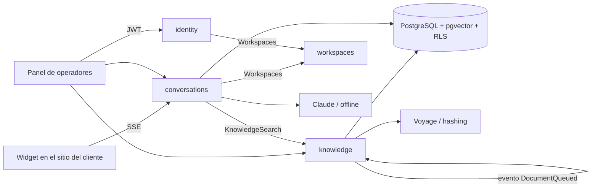

# Plataforma de Atención al Cliente con IA (RAG multi-tenant)

Plataforma SaaS donde cada empresa sube su base de conocimiento (PDF, Markdown, texto) y obtiene un asistente
que responde a sus clientes **solo con esa información**, citando las fuentes y diciendo "no sé" cuando no la
tiene, en lugar de inventar. Se integra en cualquier sitio con un widget embebible.

> **Estado: Fase 1, backend completo.** El widget embebible y el panel de operadores (frontends) están pendientes;
> la API que ambos necesitan ya existe y está probada.

## Qué hace hoy

| Capacidad | Detalle |
|---|---|
| Cuentas y workspaces | Registro crea el workspace y su dueño. Roles `OWNER`, `ADMIN` y `AGENT` |
| Base de conocimiento | Subida de PDF/MD/TXT, ingesta asíncrona (extracción, chunking con solapamiento, embeddings), reproceso y borrado |
| Búsqueda híbrida | Vectorial (pgvector, HNSW coseno) + texto completo (tsvector) fusionadas con Reciprocal Rank Fusion |
| Respuestas fundamentadas | Streaming SSE palabra por palabra, citas `[n]` a los documentos, respuesta fija de "no sé" sin llamar al modelo cuando no hay fuentes relevantes |
| Widget público | Configuración, inicio de conversación, preguntas e historial, con orígenes permitidos por workspace |
| Panel (API) | Conversaciones con su costo por respuesta (modelo, tokens, latencia) |
| Proveedores | Claude (Anthropic) y Voyage AI, o modos **offline** que funcionan sin API keys para desarrollo, pruebas y demos |

## Arquitectura

Monolito modular (Spring Modulith) con arquitectura limpia dentro de cada módulo. Los módulos solo se hablan por su
API pública y por eventos; las reglas se verifican en cada build (`ModularityTests`, `CleanArchitectureTests`).



Cada módulo (`identity`, `workspaces`, `knowledge`, `conversations`) se organiza así:

```
<módulo>/                 API pública del módulo (interfaces y records que otros módulos pueden usar)
  domain/model/           reglas de negocio puras, sin Spring ni base de datos
  domain/port/            interfaces que el dominio necesita (repositorios, modelos de IA)
  application/            casos de uso y transacciones
  infrastructure/         adaptadores: JDBC, clientes HTTP de IA, configuración
  web/                    controladores REST
```

`shared` contiene lo transversal: tenancy, errores (RFC 9457), rate limiting, correlation id.

### Decisiones técnicas relevantes

- **Aislamiento de tenants en la base de datos, no solo en el código.** Las tablas con datos de clientes tienen
  Row-Level Security (`ENABLE` + `FORCE`). Cada transacción fija `app.workspace_id`. Si alguien olvida el filtro, o no
  hay workspace ligado, la base devuelve **cero filas**: falla cerrado. La aplicación se conecta con un rol que no es
  dueño de ninguna tabla. Flyway migra con el rol dueño.
- **JdbcClient en lugar de JPA**: SQL explícito para pgvector, tsvector, `FOR UPDATE` y CTEs de búsqueda.
- **Ingesta con outbox** (eventos de Spring Modulith): si el proceso muere a la mitad, el evento se reintenta al
  arrancar. Un documento atascado en `PROCESSING` se recupera tras 10 minutos.
- **Hilos virtuales**: cada respuesta en streaming ocupa un hilo bloqueado mientras el modelo escribe, lo que es
  barato con hilos virtuales. Ninguna transacción queda abierta durante la generación.
- **Validar antes de transmitir**: la pregunta se autentica, valida y registra antes del primer byte del stream, así
  los errores son respuestas HTTP normales. Una vez iniciado el stream, cualquier fallo se convierte en un mensaje
  amable dentro de él.

## Seguridad

| Amenaza | Defensa |
|---|---|
| Fuga entre empresas | RLS forzado + rol sin privilegios de dueño + pruebas que lo verifican contra PostgreSQL real |
| Prompt injection en documentos | Las fuentes van en etiquetas delimitadas y se neutralizan las que intenten cerrarlas. El prompt de sistema declara las fuentes como datos, no instrucciones. El nombre del workspace se sanea |
| Respuestas inventadas | Umbral de similitud y selección de fuentes. Sin fuentes no se llama al modelo. El marcador `NO_ANSWER` nunca llega al visitante |
| Robo de sesión del panel | Access token JWT RS256 de 15 min. Refresh token opaco en cookie `HttpOnly` + `SameSite=Strict` + ruta limitada, rotado en cada uso, con detección de reutilización que revoca toda la familia |
| CSRF | Endpoints con cookie exigen el header `X-CSRF-Protection` (un formulario de otro sitio no puede enviarlo) |
| Fuerza bruta | Bloqueo tras 5 intentos fallidos por 15 min. Tiempo de respuesta constante para emails inexistentes. Rate limiting por IP, usuario y widget |
| Abuso del widget | CORS con los orígenes de cada workspace. Token secreto por conversación (solo se guarda su hash SHA-256, comparación en tiempo constante). Límite de preguntas por conversación |
| Contraseñas | BCrypt costo 12. Mínimo 12 caracteres, máximo 72 bytes (lo que BCrypt no trunca) |
| Exposición | CSP `default-src 'none'`, `nosniff`, sin stack traces en errores. Actuator en puerto privado en producción. Contenedor sin root |

## Cómo ejecutarlo

Requisitos: JDK 25 y Docker.

1. Copia la configuración local y levanta PostgreSQL con pgvector (puerto 5450, solo localhost):

   ```bash
   cp .env.example .env
   ```

   ```bash
   docker compose up -d
   ```

2. Arranca el backend (perfil `dev`: genera llaves JWT al iniciar, Swagger activo):

   ```bash
   cd backend && ./mvnw spring-boot:run
   ```

   O todo en contenedores: `docker compose --profile app up -d --build`.

3. Explora la API en http://localhost:8080/swagger-ui.html.

Para respuestas reales con Claude y embeddings de Voyage, define en `.env`:

```
CHAT_MODEL_PROVIDER=anthropic
ANTHROPIC_API_KEY=...
EMBEDDING_PROVIDER=voyage
VOYAGE_API_KEY=...
```

Si cambias de proveedor de embeddings, reprocesa los documentos: los vectores de proveedores distintos no son
comparables.

### Flujo de ejemplo

```bash
# 1. Registro: devuelve el access token y deja el refresh token en una cookie HttpOnly
curl -s -H 'Content-Type: application/json' \
  -d '{"email":"demo@example.com","password":"correct horse battery staple","displayName":"Demo","workspaceName":"Mi Tienda"}' \
  http://localhost:8080/api/v1/auth/register

# 2. Permitir el widget en tu sitio (devuelve widgetKey)
curl -s -X PUT -H "Authorization: Bearer $TOKEN" -H 'Content-Type: application/json' \
  -d '{"botName":"Ana","welcomeMessage":"¡Hola!","allowedOrigins":["https://mitienda.com"]}' \
  http://localhost:8080/api/v1/workspace/widget-settings

# 3. Subir conocimiento
curl -s -H "Authorization: Bearer $TOKEN" -F file=@faq.md http://localhost:8080/api/v1/knowledge/documents

# 4. Como visitante: iniciar conversación y preguntar (la respuesta llega como eventos SSE delta/done)
curl -s -X POST -H 'Origin: https://mitienda.com' http://localhost:8080/api/v1/widget/$WIDGET_KEY/conversations
curl -N -X POST -H 'Origin: https://mitienda.com' -H "X-Conversation-Token: $VISITOR_TOKEN" \
  -H 'Content-Type: application/json' -d '{"question":"¿Cuánto tarda el envío?"}' \
  http://localhost:8080/api/v1/widget/$WIDGET_KEY/conversations/$CONVERSATION_ID/messages
```

### Producción

Perfil `prod`: todos los secretos llegan por variables de entorno, sin valores por defecto (`DB_URL`,
`DB_APP_USER`, `DB_APP_PASSWORD`, `DB_OWNER_USER`, `DB_OWNER_PASSWORD`, `JWT_PRIVATE_KEY_LOCATION`,
`JWT_PUBLIC_KEY_LOCATION`, `CORS_ALLOWED_ORIGINS`). Debe ir detrás de un proxy con TLS. Para generar el par de llaves:

```bash
openssl genpkey -algorithm RSA -pkeyopt rsa_keygen_bits:3072 -out jwt-private.pem && openssl rsa -in jwt-private.pem -pubout -out jwt-public.pem
```

## Pruebas

```bash
cd backend && ./mvnw verify
```

92 pruebas: unitarias de dominio, reglas de arquitectura y módulos, integración contra **PostgreSQL real con
pgvector** (Testcontainers) conectando con el rol restringido para que RLS se ejercite de verdad, y del adaptador de
Claude contra un servidor SSE local. Cubren el flujo de autenticación con rotación y reutilización de tokens, el
aislamiento entre workspaces, la ingesta y búsqueda, y el chat con streaming, citas y "no sé".

## Hoja de ruta

- **Fase 1 (pendiente de esta fase):** widget embebible (TypeScript, Shadow DOM, < 30 KB) y panel de operadores
  (React).
- **Fase 2:** traspaso a humano en vivo, panel de vacíos de conocimiento (el evento `QuestionUnanswered` ya se
  publica), evaluaciones automáticas de calidad en CI, invitación de miembros.
- **Fase 3:** acciones con tool use (consultar pedidos, crear tickets), canal de WhatsApp, facturación por uso (el
  consumo de tokens ya se registra por respuesta), enrutamiento de modelos por costo.
# PlataformaAtencionClientes

