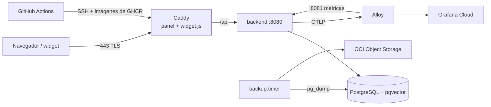

# Operación

Producción, despliegue en Oracle Cloud, monitoreo con Grafana Cloud y la prueba de carga.

## Producción

Perfil `prod`: todos los secretos llegan por variables de entorno, sin valores por defecto (`DB_URL`,
`DB_APP_USER`, `DB_APP_PASSWORD`, `DB_OWNER_USER`, `DB_OWNER_PASSWORD`, `JWT_PRIVATE_KEY_LOCATION`,
`JWT_PUBLIC_KEY_LOCATION`, `CORS_ALLOWED_ORIGINS`, `SECRETS_ENCRYPTION_KEY`, `LEGAL_CONTACT_EMAIL`). La llave de cifrado son 32 bytes
aleatorios en Base64 (`openssl rand -base64 32`). Si se pierde, los secretos guardados no se pueden leer: hay que
rotar el secreto de firma y volver a conectar WhatsApp, Messenger, Instagram y el buzón. `WHATSAPP_GRAPH_BASE_URL` cambia la versión de la Graph API.
Debe ir detrás de un proxy con TLS: el despliegue de abajo usa Caddy.

Varias instancias: el rate limiting cuenta en la memoria de cada una, así que con dos un cliente tiene el doble de
intentos. Con `RATE_LIMIT_STORE=redis` y `REDIS_URL` (p. ej. `redis://redis:6379`) todas comparten los contadores en
Redis. En el despliegue de abajo basta con agregar a `.env`:

```
COMPOSE_PROFILES=replicas
BACKEND_REPLICAS=2
RATE_LIMIT_STORE=redis
REDIS_URL=redis://redis:6379
```

El perfil `replicas` levanta Redis (solo contadores, sin disco, 64 MB), `BACKEND_REPLICAS` el número de backends y
Caddy los encuentra por nombre y los turna; el que deja de responder sale de la rotación. Con monitoreo,
`COMPOSE_PROFILES=monitoring,replicas`. Dos réplicas caben en las 60 conexiones de PostgreSQL con el pool de 20 de
cada una; para tres, baja `DB_POOL_SIZE`. Si Redis no responde, las peticiones pasan sin limitar (`supportchat_rate_limit_unavailable_total` las cuenta)
en vez de tumbar la API. Los eventos entre módulos que fallan (p. ej. una respuesta que WhatsApp no aceptó por estar
caído) se reintentan cada minuto, hasta 5 veces y durante un día, y una sola instancia toma cada uno.

Cobro: los planes (`supportchat.billing.plans` en `application.yml`) y las recargas (`supportchat.billing.top-ups`)
son de ejemplo; ajústalos a tus tarifas. Sin
`STRIPE_SECRET_KEY` y `STRIPE_WEBHOOK_SECRET` los pagos quedan apagados y todos usan el plan gratuito. Para activarlos:

```bash
# Medidores, productos y precios (con claves de búsqueda supportchat_<plan>[_<métrica>] y
# supportchat_topup_<recarga>) y el webhook.
# Se puede repetir sin duplicar nada; empieza con una llave de prueba sk_test_...
STRIPE_SECRET_KEY=sk_test_... scripts/stripe-setup.sh https://tu-dominio/api/v1/billing/stripe/webhook
```

El script imprime `STRIPE_WEBHOOK_SECRET`. Activa también el portal de clientes en el dashboard de Stripe y fija
`BILLING_RETURN_URL` a la página **Plan y pagos** del panel. Si cambias los planes o las recargas en `application.yml`,
cambia igual los arreglos `PLANS` y `TOP_UPS` del script. En local, `stripe listen --forward-to localhost:8080/api/v1/billing/stripe/webhook`
reenvía los eventos. Para generar el par de llaves:

```bash
openssl genpkey -algorithm RSA -pkeyopt rsa_keygen_bits:3072 -out jwt-private.pem && openssl rsa -in jwt-private.pem -pubout -out jwt-public.pem
```

Administración de la plataforma: después de crear tu cuenta, copia el `id` que devuelve `GET /api/v1/me` a
`PLATFORM_ADMIN_USER_IDS` y reinicia. En el panel aparece **Plataforma → Espacios de trabajo**. Cada suspensión y
reactivación queda en el log con el id de quien la hizo.

Demo pública: con el despliegue de abajo funcionando, prepara el workspace de la demo con la API (crea la cuenta o
entra con ella, sube `deploy/demo/knowledge` y permite el widget en tu dominio; necesita `curl` y `jq`):

```bash
DEMO_URL=https://tu-dominio DEMO_EMAIL=demo@tu-dominio DEMO_PASSWORD='...' deploy/demo/seed-demo.sh
```

El script imprime `DEMO_WORKSPACE_ID` y `DEMO_WIDGET_KEY`; ponlos en `/opt/supportchat/.env` y reinicia
(`docker compose up -d`). Ese workspace responde siempre con `ANTHROPIC_SIMPLE_MODEL`, da hasta `DEMO_DAILY_ANSWERS`
(300) respuestas al día (después pasa las conversaciones al equipo, como un plan agotado) y cada visitante puede
hacer 8 preguntas cada 10 minutos. `https://tu-dominio/demo` muestra la página con el widget; sin
`DEMO_WIDGET_KEY` explica que falta configurarla. Si rotas la llave del widget de la demo, actualiza la variable.

Frontends: `npm run build` deja archivos estáticos en `widget/dist/widget.js` y `panel/dist/`. Las direcciones se
fijan al compilar (ver `panel/.env.example`). Lo más simple es servir el panel en el mismo dominio que la API, con el
proxy enviando `/api` al backend; si van en dominios distintos, agrega el del panel a `CORS_ALLOWED_ORIGINS`.
`widget.js` se publica en un CDN o cualquier hosting estático.

## Despliegue en Oracle Cloud (Always Free)

Todo cabe en la capa gratuita: una VM Ampere A1 (arm64, hasta 4 OCPU y 24 GB) con Docker Compose, Caddy con TLS de
Let's Encrypt, PostgreSQL con pgvector, respaldos nocturnos a Object Storage y despliegue desde GitHub Actions por
SSH. Los archivos están en [`deploy/`](../deploy) y el flujo en
[`.github/workflows/deploy.yml`](../.github/workflows/deploy.yml).



Solo Caddy publica puertos (80 y 443). La base de datos, el puerto de gestión del backend y Alloy quedan en la red
interna de Docker. Los secretos viven solo en la VM, en `/opt/supportchat/.env` y `secrets/`: GitHub guarda la llave
SSH con la que despliega y nada más.

1. **Cuenta y red.** Crea la cuenta de Oracle Cloud (pide tarjeta para verificar, pero no cobra lo que es Always
   Free). En **Networking → Virtual Cloud Networks** usa el asistente *VCN with Internet Connectivity*. En la
   *security list* de la subred pública agrega reglas de entrada desde `0.0.0.0/0` para TCP 80, TCP 443 y UDP 443.
   SSH (22) ya viene abierto; GitHub Actions entra por ahí solo con llave.
2. **VM.** En **Compute → Instances** crea una con imagen *Canonical Ubuntu 24.04* (aarch64) y forma
   `VM.Standard.A1.Flex` con 4 OCPU y 24 GB (o 2 y 12), con disco de arranque de 100 GB (el gratuito llega a 200 GB).
   Si quieres una IP fija, resérvala en **Networking → Reserved public IPs**. Si no, el temporizador de DuckDNS
   actualiza el nombre solo. Oracle puede reclamar instancias A1 gratuitas que pasan 7 días casi sin uso; pasar la
   cuenta a *Pay As You Go* lo evita y sigue sin costo dentro de los límites gratuitos.
3. **Nombre.** En [duckdns.org](https://www.duckdns.org) crea un subdominio (p. ej. `misoporte.duckdns.org`) y copia el
   token. Con un dominio propio, basta un registro A hacia la IP de la VM.
4. **Respaldos.** En **Storage → Buckets** crea `supportchat-backups` (privado, Standard) y una regla de ciclo de vida
   que borre los objetos con prefijo `postgres/` de más de 30 días. Para que la VM suba sin llaves, crea en
   **Identity → Dynamic groups** el grupo `supportchat-vm` con `ALL {instance.id = '<OCID de la VM>'}` y esta política
   en el compartment:

   ```text
   Allow dynamic-group supportchat-vm to read objectstorage-namespaces in tenancy
   Allow dynamic-group supportchat-vm to manage objects in compartment <compartment> where target.bucket.name = 'supportchat-backups'
   ```

5. **Preparar la VM.** Crea la llave de despliegue y ejecuta el script de preparación. Instala Docker, abre 80 y 443
   en el iptables que traen las imágenes de Oracle, crea el usuario `deploy`, genera las llaves JWT e instala los
   temporizadores de respaldo y DuckDNS:

   ```bash
   ssh-keygen -t ed25519 -f deploy_key -N "" -C github-actions
   scp -r deploy ubuntu@<IP>:/tmp/
   ssh ubuntu@<IP> sudo bash /tmp/deploy/scripts/setup-vm.sh "\"$(cat deploy_key.pub)\""
   ```

6. **Configurar.** Completa `/opt/supportchat/.env` en la VM (`sudo -u deploy nano /opt/supportchat/.env`) a partir
   de [`deploy/.env.example`](../deploy/.env.example): dominio, contraseñas (`openssl rand -base64 24`),
   `SECRETS_ENCRYPTION_KEY`, el correo de contacto de la política de privacidad (`LEGAL_CONTACT_EMAIL`), llaves de
   Anthropic y Voyage, `OCI_NAMESPACE` (`oci os ns get --auth instance_principal`)
   y DuckDNS. Guarda fuera de la VM una copia de `SECRETS_ENCRYPTION_KEY` y de `secrets/`.
7. **GitHub.** En **Settings → Secrets and variables → Actions** agrega los secretos `DEPLOY_HOST` (IP o nombre),
   `DEPLOY_SSH_KEY` (contenido de `deploy_key`) y `DEPLOY_KNOWN_HOSTS` (salida de `ssh-keyscan -t ed25519 <IP>`;
   compara la huella con la consola de la VM). Agrega también la variable `PUBLIC_DOMAIN`. Si creas el environment
   `production` con revisores obligatorios, cada despliegue espera una aprobación.
8. **Desplegar.** **Actions → deploy → Run workflow**. Desde ahí, cada push a `main` con la CI en verde se despliega
   solo:
   - construye las imágenes arm64 (el backend y `web`: Caddy con el panel y `widget.js` compilados para tu dominio);
   - las publica en GHCR con el commit como etiqueta;
   - copia compose, scripts y configuración a la VM;
   - espera a que el backend esté sano (`docker compose up --wait`);
   - comprueba que el panel, el widget y la API respondan.

   Para volver atrás, ejecuta el flujo a mano con `image_tag` igual a los 12 primeros caracteres de un commit ya
   desplegado.

El widget se instala con `<script src="https://<tu-dominio>/widget.js" data-widget-key="..." async></script>`. Toma la
API del mismo origen del script.

**Respaldos.** `supportchat-backup.timer` corre cada noche a las 03:30 UTC:

- `pg_dump` en formato custom, comprobado con `pg_restore --list`;
- cifrado con [age](https://age-encryption.org) si defines `BACKUP_AGE_RECIPIENT`;
- subido a `postgres/` en el bucket;
- 7 días de copias también en la VM;
- los domingos (`RESTORE_TEST_WEEKDAY`), una prueba de restauración del dump de esa noche, antes de cifrarlo.

La prueba ([`restore-test.sh`](../deploy/scripts/restore-test.sh)) restaura el dump en un contenedor PostgreSQL
desechable, nunca en la base real, y comprueba que:

- `pg_restore` termine sin errores;
- ninguna migración haya fallado;
- haya al menos un workspace;
- el rol de la aplicación no vea conversaciones sin un workspace asignado, y con uno vea solo las suyas.

Si falla, el dump se sube igual, pero el servicio termina con error y no hace el ping, así que healthchecks.io te
avisa.

Si pones `BACKUP_PING_URL` (de healthchecks.io, gratis), te avisa cuando una noche falta. Para restaurar o probar:

```bash
sudo systemctl start supportchat-backup.service && journalctl -u supportchat-backup -n 20   # respaldo a mano
sudo -u deploy /opt/supportchat/scripts/restore-test.sh                                       # prueba el último
sudo -u deploy /opt/supportchat/scripts/restore.sh postgres/supportchat-20261110T033000Z.dump  # desde el bucket
```

Con `BACKUP_AGE_RECIPIENT`, la VM no tiene la clave privada. Para probar un `.dump.age` descargado, hazlo en tu equipo
con Docker: `AGE_IDENTITY=~/age-key.txt deploy/scripts/restore-test.sh supportchat-....dump.age`.

## Monitoreo (Grafana Cloud gratis)

El backend publica métricas de Prometheus en el puerto privado de Actuator (`:8081/actuator/prometheus` en `prod`;
el puerto público responde 403 a `/actuator/**`) y envía trazas por OTLP cuando hay un colector configurado. En el
servidor corre **Grafana Alloy** ([`deploy/monitoring/alloy/config.alloy`](../deploy/monitoring/alloy/config.alloy)):
lee esas métricas y las de la VM (CPU, memoria, disco), recibe las trazas y lo manda todo a Grafana Cloud. Las
credenciales solo las tiene Alloy.

| Métrica | Etiquetas | Qué mide |
|---|---|---|
| `supportchat_answer_duration_seconds` | `channel`, `outcome` | Tiempo de cada respuesta y si se respondió, no se sabía o falló |
| `supportchat_llm_tokens_total` | `type`, `tier` | Tokens del modelo de lenguaje, por modelo elegido |
| `supportchat_conversations_started_total` | `channel` | Conversaciones nuevas |
| `supportchat_conversations_handoffs_total` | `channel`, `reason` | Traspasos a una persona (botón, lo pidió por escrito, agotó las preguntas) |
| `supportchat_feedback_answers_total`, `supportchat_feedback_ratings` | `helpful` | 👍/👎 y calificaciones de 1 a 5 |
| `supportchat_actions_runs_total` | `status` | Ejecuciones de acciones (pendiente, hecha, fallida, cancelada, rechazada...) |
| `supportchat_actions_calls_seconds` | `target`, `outcome` | Llamadas a webhooks, Shopify o Zendesk |
| `supportchat_channel_messages_received_total`, `supportchat_channel_deliveries_total` | `channel`, `outcome` | Mensajes recibidos y respuestas entregadas, rechazadas o reintentadas |
| `supportchat_channel_mailbox_reads_total` | `outcome` | Lecturas de buzones |
| `supportchat_rate_limit_rejections_total`, `supportchat_business_rejections_total` | `rule`, `code` | Peticiones limitadas y errores de negocio |
| `supportchat_rate_limit_unavailable_total` | | Peticiones que pasaron sin limitar porque Redis no respondió |

Las etiquetas nunca llevan el workspace, el contacto ni el nombre de una acción: el número de series no crece con
los clientes (el plan gratuito incluye 10 000) y no salen datos de los clientes. El consumo por workspace sigue en
la página **Consumo**. Las trazas usan el 10 % de las peticiones (`TRACING_SAMPLING_PROBABILITY`), y cada línea de
log lleva `[traceId,spanId]` para saltar del log a su traza.

1. Crea una cuenta gratuita en Grafana Cloud. En **Connections → Add new connection → OpenTelemetry (OTLP)** genera
   un token con permisos `metrics:write`, `traces:write` (y `rules:write` si cargarás las alertas con `mimirtool`).
   De ahí salen `GRAFANA_CLOUD_OTLP_ENDPOINT` (`https://otlp-gateway-<región>.grafana.net/otlp`) y
   `GRAFANA_CLOUD_OTLP_USER` (el ID de la instancia). En **Prometheus → Details** están
   `GRAFANA_CLOUD_PROMETHEUS_URL` (`https://prometheus-<región>.grafana.net/api/prom/push`) y
   `GRAFANA_CLOUD_PROMETHEUS_USER`.
2. Pon esos valores y `GRAFANA_CLOUD_API_TOKEN` en el `.env` del servidor; el backend recibe
   `OTEL_EXPORTER_OTLP_ENDPOINT=http://alloy:4318` (ver la sección de despliegue). Sin Alloy, el backend también
   puede enviar directo: `OTEL_EXPORTER_OTLP_ENDPOINT` con la URL del gateway y
   `OTEL_EXPORTER_OTLP_HEADERS=Authorization=Basic <base64 de usuario:token>`. Sin ninguna, no se envían trazas.
3. Importa el tablero [`deploy/monitoring/grafana-dashboard.json`](../deploy/monitoring/grafana-dashboard.json)
   (Dashboards → New → Import) y carga las alertas desde **Alerting → Alert rules → Import** (sube el YAML) o con:

```bash
mimirtool rules load deploy/monitoring/alerts.yml --address=<URL de Prometheus, sin /push> \
  --id=<GRAFANA_CLOUD_PROMETHEUS_USER> --key=<token con rules:write>
```

Las [alertas](../deploy/monitoring/alerts.yml) avisan si el backend no responde, si más del 5 % de las peticiones dan
5xx, si el pool de conexiones se agota, si fallan más del 10 % de las respuestas o el p95 pasa de 20 s, si se disparan
los tokens, si un webhook o una integración falla, si las respuestas de un canal no llegan, si los buzones no se
pueden leer, si hay una tormenta de 429 y si el disco o la memoria de la VM se acaban. El aviso (correo, Slack,
Telegram) se configura en **Alerting → Contact points**. `promtool check rules` las valida (está en el comentario del
archivo).

## Prueba de carga

[`loadtest/`](../loadtest) trae un escenario de [k6](https://k6.io) y su propio entorno: base de datos, backend
construido desde este código y k6 en una red privada, sin tocar tu base de desarrollo. Mide la plataforma (búsqueda,
almacenamiento, streaming, RLS) con el modelo offline y embeddings locales, así que no gasta tokens ni mide la latencia
de Anthropic o Voyage.

```bash
docker compose -f loadtest/docker-compose.yml up --build --abort-on-container-exit --exit-code-from k6
```

```bash
docker compose -f loadtest/docker-compose.yml down -v
```

- **Visitantes:** abren el widget, inician una conversación y hacen dos preguntas, leyendo cada respuesta por SSE
  hasta el evento `done`. Las conversaciones nuevas por segundo suben durante 1 minuto hasta `PEAK_RATE` (10 por
  defecto), se mantienen `HOLD` (2m) y bajan en 30 s.
- **Operadores:** 10 con la bandeja abierta, que la recargan cada 5 s.
- **Umbrales** (si uno falla, el comando sale con error): menos de 1 % de errores, p95 de la configuración del widget
  < 200 ms, de iniciar conversación < 300 ms, de la bandeja < 500 ms, de la respuesta completa < 1.5 s y más del 99 %
  de respuestas terminadas.

El resumen queda en la consola y completo en `loadtest/results/summary.json`. Para más carga:
`PEAK_RATE=50 HOLD=1m docker compose -f loadtest/docker-compose.yml up ...` (en PowerShell, define antes
`$env:PEAK_RATE=50`).

Resultados en una laptop con Docker Desktop (backend con pool de 20 conexiones), todos los umbrales cumplidos:

| | 10 conversaciones/s | 50 conversaciones/s |
|---|---|---|
| Peticiones | 7 029 (32/s) | 20 261 (96/s) |
| Errores | 0 % | 0 % |
| Respuestas terminadas | 3 302 de 3 302 | 9 918 de 9 918 |
| Configuración del widget (p95) | 4 ms | 3 ms |
| Iniciar conversación (p95) | 7 ms | 32 ms |
| Respuesta completa (p50 / p95 / p99) | 17 / 26 / 42 ms | 17 / 279 / 652 ms |
| Primer evento de la respuesta (p95) | 9 ms | 52 ms |
| Bandeja del operador (p95) | 20 ms | 41 ms |

Con Claude real, cada respuesta tarda lo que tarde el modelo (segundos), pero el backend lo aguanta: el stream ocupa
un hilo virtual, no uno del sistema, y la conexión a la base de datos se suelta antes de llamar al modelo. Lo que
limita en producción es el plan de Anthropic, no la VM.

### Contra una copia de producción

[`loadtest/production/`](../loadtest/production) corre el mismo escenario como en producción: perfil `prod` con
llaves JWT y cifrado, **dos instancias** del backend detrás de Caddy por HTTPS, Redis con los límites compartidos y el
rate limiting encendido. Cada visitante llega desde su propia dirección (Caddy acepta `X-Forwarded-For` solo de la
red privada, como el backend), y un abusador inicia dos conversaciones por segundo desde una sola: los límites deben
frenarlo aunque sus peticiones caigan en instancias distintas.

```bash
bash loadtest/production/prepare.sh
```

```bash
docker compose -f loadtest/production/docker-compose.yml up --build --detach --wait web
```

```bash
docker compose -f loadtest/production/docker-compose.yml run --rm k6
```

```bash
docker compose -f loadtest/production/docker-compose.yml down -v
```

k6 corre aparte del resto para que detener una instancia no corte la prueba. Para ver qué pasa si una cae, detén una
a media prueba y vuelve a arrancarla:

```bash
docker compose -f loadtest/production/docker-compose.yml stop backend-b
```

```bash
docker compose -f loadtest/production/docker-compose.yml start backend-b
```

Resultado en una laptop (Docker Desktop, 10 conversaciones nuevas por segundo en el pico, cada una con dos preguntas,
10 operadores con la bandeja abierta), con `backend-b` detenido 40 s a mitad del pico:

| Medida | Resultado |
| --- | --- |
| Peticiones | 9,666 (35/s), **0 % fallidas**, también mientras `backend-b` estaba detenido |
| Respuestas | 4,500 completas, 0 perdidas |
| Abusador (una dirección, 2/s por 1 min) | 10 admitidas, 111 limitadas (429), aunque round robin las repartió en las dos instancias |
| Config del widget | p95 6 ms |
| Iniciar conversación | p95 10 ms |
| Respuesta completa (modelo offline) | p95 36 ms, primer byte p95 12 ms |
| Bandeja del operador | p95 24 ms |
| Errores en los logs del backend | 0 |

Caddy saca de la rotación la instancia que deja de responder y reintenta en la otra la petición que no pudo
entregarle, y el apagado ordenado de Spring termina las que ya tenía en curso.

Con el modelo offline cada respuesta tarda milisegundos. Para medir con respuestas que tardan lo que tarda Claude,
[`docker-compose.model.yml`](../loadtest/production/docker-compose.model.yml) agrega un simulador
([`model-stub/stub.py`](../loadtest/production/model-stub/stub.py)) que habla el protocolo de streaming de la API de
Mensajes y el de embeddings de Voyage: 0.8–2 s hasta el primer token y unos 60 tokens por segundo. El backend usa
sus clientes reales de Anthropic y Voyage contra él, sin salir de la red privada ni gastar en las APIs:

```bash
docker compose -f loadtest/production/docker-compose.yml -f loadtest/production/docker-compose.model.yml up --build --detach --wait web
```

```bash
docker compose -f loadtest/production/docker-compose.yml -f loadtest/production/docker-compose.model.yml run --rm k6
```

Resultado con el mismo tráfico y `backend-b` detenido 40 s a mitad del pico: 9,528 peticiones, 4,430 respuestas
completas y 0 perdidas, hasta 59 respuestas transmitiéndose a la vez, respuesta completa p50 2.3 s y p95 3.3 s (casi
todo es el modelo simulado; el primer byte sigue en p95 13 ms) y el resto de las latencias igual que sin modelo.
Falló **una** petición (0.01 %): un `POST` que Caddy mandó a `backend-b` en el mismo segundo en que se apagaba, por
una conexión que el backend cerró al detenerse. Caddy no reintenta un `POST` que ya envió, porque podría repetirlo;
es el costo de detener una réplica con tráfico.
